# Dogfooding Session - October 2, 2026

Observations reported while using Buddy during the October 2, 2026 dogfooding session.

---

## Session Guidelines

- **Faithful capture:** Record problems directly from the user's accounts while using the running app.
- **No speculative causes:** Do not inspect code to invent or guess causes; record observed vs. expected behavior and mark unknowns as unknown.
- **Transcript preservation:** Preserve the exact transcript of every dogfooding message alongside each issue so original context, nuance, and intent are never lost.
- **Atomic structure:** Keep issues atomic, non-nested, and clearly categorized.

---

## Issues & Transcripts

### Issue 01: Skill and Reference Guidance for Writing High-Quality Assessment Questions

- **Category:** Feature request / Pedagogical skill.
- **Tags:** `skills`, `pedagogy`, `quizzing`, `prompts`
- **Status:**
  - [x] To do
  - [ ] Doing
  - [ ] Done
- **Timestamp:** `2026-10-02 14:55`

#### Context & Problem
While Buddy has a quiz tool to generate exercises, the agent lacks embedded expertise on question design. It currently lacks codified guidance on how to write rigorous questions, avoid predictable answer placement (e.g. favoring a particular option number), avoid weak/obvious distractors that make answers trivial to guess, and write diverse question types effectively.

#### Feedback & Suggested Direction
- Create a dedicated skill or skill reference (e.g., assessment / question-writing guidance) compiling documented best practices and anti-patterns.
- Address multiple-choice construction (stem clarity, plausible distractors, randomized answer distributions, eliminating accidental cues).
- Extend guidance beyond multiple-choice to other question formats (e.g. short answer, conceptual checks).

#### Raw Transcript
```md
So, in general we want to improve the quizzing system in Buddy. By that I mean like it has multiple parts. Thing is like how to write multiple choice questions for example. So when the user asks for a quiz of course we have the quiz tool to create a exercise but we don't have a full repository on how to write great questions, how to write great multiple choice questions, what are the common mistakes for writing questions? For example, choosing the same numbered option again and again, making it you know what making it so that it's easier to guess and there are like so many common issues and there's some great documentation on this. So we might convert that into a skill or a skill reference to improve the general multiple choice question system, right? And this is not just from multiple choice, like we can do this for different question types. And along with that we can also add some kind of product docs so Buddy can decide what product surface to create, what kind of a quiz. We have multiple surfaces like we have in chat question tool, we have a whole quizzing tool, we have HTML pages that can that the agent can make. So all these can be quizzing exercise, quizzing surfaces, right? So we need to figure out what is the right surface to present what kind of quiz and then how much that quiz should be, what is it testing, how to write those question types, what are the best ways to write those question types. So all this knowledge needs to be embedded so that we can nudge the agent in the correct direction
```

---

### Issue 02: Quizzing Surface Selection & Assessment Routing Guidance

- **Category:** UX/design proposal & Product guidance.
- **Tags:** `bench`, `ui`, `prompts`, `product-routing`, `quizzing`
- **Status:**
  - [x] To do
  - [ ] Doing
  - [ ] Done
- **Timestamp:** `2026-10-02 14:55`

#### Context & Problem
Buddy offers multiple surfaces that can deliver assessment experiences:
1. In-chat question tool (quick check / interactive dialogue prompt).
2. Dedicated quizzing tool / Bench exercise surface.
3. Interactive HTML widget pages.

However, Buddy currently lacks product documentation or routing rules to help the agent decide which surface to select for a given assessment need, what quiz length/scope is appropriate, and how the format aligns with what is being tested.

#### Feedback & Suggested Direction
- Embed product-level decision docs / system prompt guidance to nudge Buddy to choose the right surface:
  - Quick, single-concept checks in-chat vs. multi-question structured assessments in the Bench quizzing tool vs. rich interactive simulations/widgets in HTML pages.
  - Guidelines on assessing quiz scope (number of questions vs. cognitive load), target objectives, and formatting for each surface.

#### Raw Transcript
```md
So, in general we want to improve the quizzing system in Buddy. By that I mean like it has multiple parts. Thing is like how to write multiple choice questions for example. So when the user asks for a quiz of course we have the quiz tool to create a exercise but we don't have a full repository on how to write great questions, how to write great multiple choice questions, what are the common mistakes for writing questions? For example, choosing the same numbered option again and again, making it you know what making it so that it's easier to guess and there are like so many common issues and there's some great documentation on this. So we might convert that into a skill or a skill reference to improve the general multiple choice question system, right? And this is not just from multiple choice, like we can do this for different question types. And along with that we can also add some kind of product docs so Buddy can decide what product surface to create, what kind of a quiz. We have multiple surfaces like we have in chat question tool, we have a whole quizzing tool, we have HTML pages that can that the agent can make. So all these can be quizzing exercise, quizzing surfaces, right? So we need to figure out what is the right surface to present what kind of quiz and then how much that quiz should be, what is it testing, how to write those question types, what are the best ways to write those question types. So all this knowledge needs to be embedded so that we can nudge the agent in the correct direction
```

---

### Issue 03: Agent Access to Notes for Cross-Notebook Memory & Context

- **Category:** Feature request / Architecture.
- **Tags:** `notes`, `memory`, `agent-loop`, `full-stack`
- **Status:**
  - [x] To do
  - [ ] Doing
  - [ ] Done
- **Timestamp:** `2026-10-02 14:59`

#### Context & Problem
Buddy has a notes system, but the agent currently lacks any access to or awareness of saved notes. The agent does not know when notes are captured and cannot query or read them to establish memory across notebooks or conversations.

#### Feedback & Suggested Direction
- Provide the agent with explicit access to saved notes (e.g. tools to list/search/read notes, or system prompt / context integration).
- Enable notes to function as cross-notebook and long-term memory so the agent can recall insights, user decisions, and preferences.

#### Raw Transcript
```md
xcAnother thing that we have been missing is like we created a node system but we never gave agent access to those nodes or made a system where the agent knows that these notes are saved to you know get memory about the other notebooks or everything. So we don't have that system at all so we need to make that work
```

---

### Issue 04: Agent Tool to Recommend Notes & Prompt Composer Banner UI

- **Category:** Feature request / UX proposal.
- **Tags:** `notes`, `tools`, `ui`, `prompt-composer`, `learning`
- **Status:**
  - [x] To do
  - [ ] Doing
  - [ ] Done
- **Timestamp:** `2026-10-02 15:00`

#### Context & Problem
During a learning session, key insights or concepts often emerge that students would benefit from retaining. Currently, note creation is entirely manual, with no mechanism for the agent to proactively suggest saving an important takeaway.

#### Feedback & Suggested Direction
- Create an agent tool (e.g. `recommend_note`) enabling Buddy to suggest notes when it identifies a key concept the student should retain.
- **UI Affordance:** Display the recommended note directly above the prompt composer (the same dock area where permission prompts and transient notices appear), allowing the user to review and save it to their notebook with one click.
- **Relevance & Grounding:** Reading existing notes from the same notebook (tied to Issue 03) will allow the agent to make more relevant recommendations without redundant suggestions.

#### Raw Transcript
```md
Also one more thing is maybe we could give an agent a tool to recommend different notes to students. So while they are learning, let's say you know some student is learning something and then agent realizes that it's like it should probably recommend this as a learning to the student so they can retain it. So at that point it could trigger a tool like recommend note or something like that where the agent recommends a note to the student and then the student can decide to save it. The UI that I have been thinking of is it just appears over the prompt composer the same position where the permission prompt appears and the other prompts appear. So then the user can decide if they want to save this agent in their notebook or not. But for this I think one thing that would be essential is like reading the old notes from the same notebook. We can also do it without toll notes but like the point is like it would be more relevant if we have the old notes
```

---

### Issue 05: `/smart-note` Slash Command with Cache-Preserving Ephemeral Draft Generation

- **Category:** Feature request / UX proposal.
- **Tags:** `notes`, `slash-commands`, `prompt-composer`, `caching`, `llm-runtime`
- **Status:**
  - [x] To do
  - [ ] Doing
  - [ ] Done
- **Timestamp:** `2026-10-02 15:03`

#### Context & Problem
Capturing notes currently relies on manual drafting or quoting an entire assistant message. There is no automated shortcut to synthesize a concise learning takeaway from the current conversation directly into an editable note draft.

#### Feedback & Suggested Direction
- Introduce a `/smart-note` slash command in the chat prompt composer.
- **Ephemeral One-Off Request:** Fire a single generation request without persisting it to the agent session database. Append to the current conversation prefix to preserve prefix cache benefits.
- **Context Grounding:** Supply existing notebook notes (if any) to contextualize and avoid duplicate notes, asking the model for a concise learning recommendation.
- **Seamless Editing:** Auto-fill the generated recommendation into the prompt composer with Note Mode activated, so the user can easily review, refine, and save the note to their notebook.

#### Raw Transcript
```md
And maybe we can also make the note-taking commands smarter. So whenever the user clicks the note-taking button or no, whenever we can add a command called slash command called smart note, where if user triggers that command, we can send a one-off request without ever saving this request to the to the agent database, we can spire a one-off request to generate kind of a suggestion without breaking the cache. By that I mean like we will just send the current history with another message saying that user has asked for notes, right? And if user has generated older notes, we will send them those older notes and then ask for a new note recommendation, a short recommendation, and then we can fill that in the prompt composer where the note status is active. So you know we can summarize the learning from the current chart very quickly and then allow the user to edit it and save it because it will be in the prompt composer by its own
```

---

### Issue 06: Elapsed Time Indicator on Last Message to Signal Cache Staleness

- **Category:** UX proposal / Performance & Cost awareness.
- **Tags:** `chat`, `ui`, `caching`, `token-cost`, `messages`
- **Status:**
  - [ ] To do
  - [ ] Doing
  - [x] Done
- **Timestamp:** `2026-10-02 15:04`

#### Context & Problem
Prompt prefix caching relies on short provider TTLs (typically 5 to 60 minutes). When a user returns to a conversation hours or days later and continues prompting, the expired cache forces a full context re-tokenization, consuming large amounts of rate limits and tokens without warning.

#### Feedback & Suggested Direction
- Show elapsed time since the last message on hover:
  - Display under the last assistant message by default.
  - If the conversation was stopped/aborted manually before an assistant reply, display under the last user message.
- Provides immediate visual feedback on session staleness and cache risk before sending another turn.

#### Raw Transcript
```md
Also, I think we need to show the how much time has passed since the last message under the last message on hover. I mean the last assistant message and if the user has stopped the conversation manually or something, then under last user message. So basically the thing is like the cache breaks right like so if we we don't show this time of the last message user might send a message like 10 days later and might that might wreck their limits. So showing the time of the last message is super super important I think
```

```md
this is shtraight forward put luna max on this. 
```

```md
why the fuck is this on left side the minute; not with the rest of the message actions. ask it to fix
```

```md
text is not aligned with icons. do it yourslef
```

```md
what the fuck is oging on with text aligment? cant you fukcing aling with baseline?
```

```md
baseline for time is looking even ugyjly. just do as before. but for recent, say 0 mins say just now
```

```md
makr this as done
```

---

### Issue 07: Voice Input Enablement via `buddy-help` Skill & Handy Voice CLI

- **Category:** Feature request / Skills & Documentation.
- **Tags:** `skills`, `buddy-help`, `voice`, `cli`, `onboarding`
- **Status:**
  - [x] To do
  - [ ] Doing
  - [ ] Done
- **Timestamp:** `2026-10-02 15:09`

#### Context & Problem
Buddy does not require native, built-in voice support. However, users frequently want voice dictation/input when interacting with Buddy, and there is currently no guided pathway or documented skill to set this up.

#### Feedback & Suggested Direction
- Rather than implementing native in-app audio recording, add guidance to the `buddy-help` skill (or a reference document within it).
- **CLI-Driven Setup:** Provide instructions for installing and configuring Handy Voice via CLI.
- **Environment-Specific Models:** Guide selection of the appropriate model in the config file based on the user's local hardware/system resources.
- **Training & Verification:** Verify the end-to-end setup purely using CLI commands (without relying on computer-use capabilities), and provide simple user training steps for using voice with Buddy.

#### Raw Transcript
```md
One more thing that we need for Wadi is voice support and we don't want voice support natively. Basically, we might add stuff to the Buddy help skill where we'll give it instructions on how to use the CLI to install handy voice, how to configure its config file with the models and everything. So you choose the good model for the current environment that the user is in, and then train the user on how to use it and everything. And all this should be first verified with CLI that can be done with CLI because all apps don't have computer use. And then once it's verified, we can create Buddy help skill and then you know Buddy help skill reference and then anyone can label voice on Buddy
```

---

### Issue 08: Non-Path Slash Notation (e.g. `tokens/s`) Erroneously Renders As File Path Chip

- **Category:** Bug candidate.
- **Tags:** `markdown`, `chat`, `ui`, `chips`, `front-end`
- **Status:**
  - [ ] To do
  - [ ] Doing
  - [x] Done
- **Timestamp:** `2026-10-02 15:12`

#### Context & Problem
When rendering assistant markdown messages, inline slash patterns intended as units or ratios (e.g. `tokens/s`) are erroneously captured by the file/path autolinking parser and rendered as interactive file chips.

#### Observed Behavior
In the text:
`p50 = 17.88 tokens/s, max = 32.98 tokens/s.`
The substring `tokens/s, max = 32.98` was parsed as a file path, rendering an inline file chip displaying `[ 📄 s, max = 32.98 ]` instead of remaining plain prose.

#### Expected Behavior
Units, ratios, or mathematical expressions containing slashes (such as `tokens/s`, `km/h`, or `items/sec`) must not trigger file path autolinking unless they match a valid workspace file or recognized file path structure.

#### Screenshot
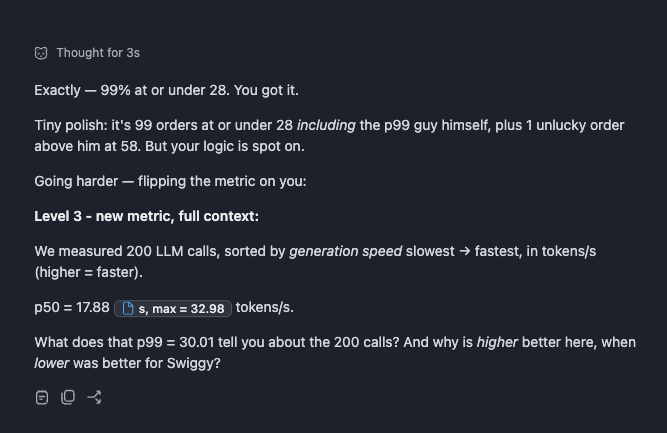
*(Source: [`/var/folders/6b/_tpzqtks48d18kr7zb8w4t800000gn/T/clipboard-2026-10-02-151157-88653DFE.png`](file:///var/folders/6b/_tpzqtks48d18kr7zb8w4t800000gn/T/clipboard-2026-10-02-151157-88653DFE.png))*

#### Raw Transcript
```md
/var/folders/6b/_tpzqtks48d18kr7zb8w4t800000gn/T/clipboard-2026-10-02-151157-88653DFE.png Exactly — 99% at or under 28. You got it.

Tiny polish: it's 99 orders at or under 28 *including* the p99 guy himself, plus 1 unlucky order above him at 58. But your logic is spot on.

Going harder — flipping the metric on you:

**Level 3 - new metric, full context:**

We measured 200 LLM calls, sorted by *generation speed* slowest → fastest, in tokens/s (higher = faster).

p50 = 17.88 tokens/s, p99 = 30.01 tokens/s, max = 32.98 tokens/s.

What does that p99 = 30.01 tell you about the 200 calls? And why is *higher* better here, when *lower* was better for Swiggy?


I am pasting the message that was rendered along with the screenshot of that message. If you see the issue something is rendering here as a chip which should not have rendered as a chip. So I need you to attach this screenshot with the issue and make this an issue
```

```md
ask sol if this is already fix; if not ask for diagonosis sol high
```

```md
Tighten path matching (Recommended)
```

```md
once this is odne; give me a prmopot to reprodice this
```

---

### Issue 09: Display Inferred Reasoning Level in Selector Instead of Generic "Default"

- **Category:** UX/design proposal.
- **Tags:** `ui`, `composer`, `models`, `reasoning-effort`, `front-end`
- **Status:**
  - [x] To do
  - [ ] Doing
  - [ ] Done
- **Timestamp:** `2026-10-02 17:23`
- **Triage:** Deferred by user on 2026-10-03. Full read-only feasibility findings are retained under Issue 09 in the triage document. No implementation.

#### Context & Problem
In the prompt composer footer, the reasoning effort dropdown displays a generic "Default" label when no explicit reasoning level is configured for the active model (e.g. GPT-6.1-Sol). This leaves the user uninformed about what level of thinking/effort is actually being applied.

#### Feedback & Suggested Direction
- Instead of showing only "Default", show the effective reasoning level that is inferred for the active model (e.g., `Default (Medium)`, `Default (High)`, or the inferred level with a default indicator).
- Helps users immediately understand model behavior and budget impact without having to open the menu or look up model specifications.

#### Screenshot
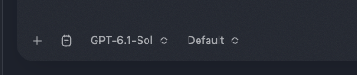
*(Source: [`/Users/prashantbhudwal/Desktop/Screenshot 2026-10-02 at 17.22.59.png`](file:///Users/prashantbhudwal/Desktop/Screenshot%202026-10-02%20at%2017.22.59.png))*

#### Raw Transcript
```md
/Users/prashantbhudwal/Desktop/Screenshot\ 2026-10-02\ at\ 17.22.59.png here instead of the defualt is it possible to show defualt resoning level what it infers to. addthis as issue.
```

```md
put a subagent to find if this is possible sol high
```

```md
defer this for now. with full findings found
```

---

### Issue 10: Bypass All Permissions / "YOLO" Mode

- **Category:** Feature request / UX proposal.
- **Tags:** `permissions`, `settings`, `runtime`, `yolo-mode`, `developer-experience`
- **Status:**
  - [x] To do
  - [ ] Doing
  - [ ] Done
- **Timestamp:** `2026-10-02 17:25`

#### Context & Problem
Continuous permission prompts for commands, file reads/writes, and tool executions become repetitive and irritating during fast-paced workflows and trusted local sessions.

#### Feedback & Suggested Direction
- Implement a global or per-session "Bypass All Permissions" / "YOLO mode" toggle in Buddy.
- When enabled, auto-approve runtime tool calls and permission requests so users are not interrupted by repeated confirmation modals.

#### Raw Transcript
```md
need to add bypass all persmissoin/yolo mode in buddy. sometimes this gets irritating
```

---

### Issue 11: Systemic Favicon 404 Failures Across External Links (Naive Root `/favicon.ico` Fetching)

- **Category:** Bug candidate.
- **Tags:** `markdown`, `chat`, `ui`, `favicon`, `external-links`, `front-end`
- **Status:**
  - [ ] To do
  - [ ] Doing
  - [x] Done
- **Timestamp:** `2026-10-02 17:25` (Updated `17:28`)

#### Context & Problem
Buddy displays favicons next to external web links in markdown chat messages. However, Buddy naively attempts to load `/favicon.ico` directly from the domain root. Many modern websites and CDNs (e.g. `hibuddy.in`, `help.openai.com`, `www-cdn.anthropic.com`, `status.claude.com`) do not serve an icon at `/favicon.ico`, but instead declare favicons via `<link rel="icon">` in the HTML document (which standard browsers like Chrome resolve without issue).

#### Observed Behavior
External links repeatedly fail to display favicons and fall back to the generic globe icon (`🌐`).
DevTools console confirms systematic 404 network errors across multiple major domains:
- `Failed to load resource: the server responded hibuddy.in/favicon.ico:1 with a status of 404 ()`
- `Failed to load resource: the server responded help.openai.com/favicon.ico:1 with a status of 404 ()`
- `Failed to load resource: the server responded www-cdn.anthropic.com/favicon.ico:1 with a status of 404 ()`
- `Failed to load resource: the server responded status.claude.com/favicon.ico:1 with a status of 404 ()`

Notably, **Buddy's own Bench browser tabs correctly show the favicon** for these exact pages (e.g., the OpenAI Help Center tab displays the OpenAI logo properly), demonstrating that Buddy already has working favicon extraction logic within the browser surface that the chat markdown renderer fails to utilize.

#### Expected Behavior
Domain favicons should be resolved using standard mechanisms (e.g. parsing page `<link rel="icon">`, sharing favicon cache/extraction logic with Buddy's Bench browser tabs, or utilizing a reliable resolver/proxy) without hardcoding `<domain>/favicon.ico` and spamming 404 network errors into the console.

#### Screenshots
- Rendered Message (Missing Favicon Fallback in Chat):
  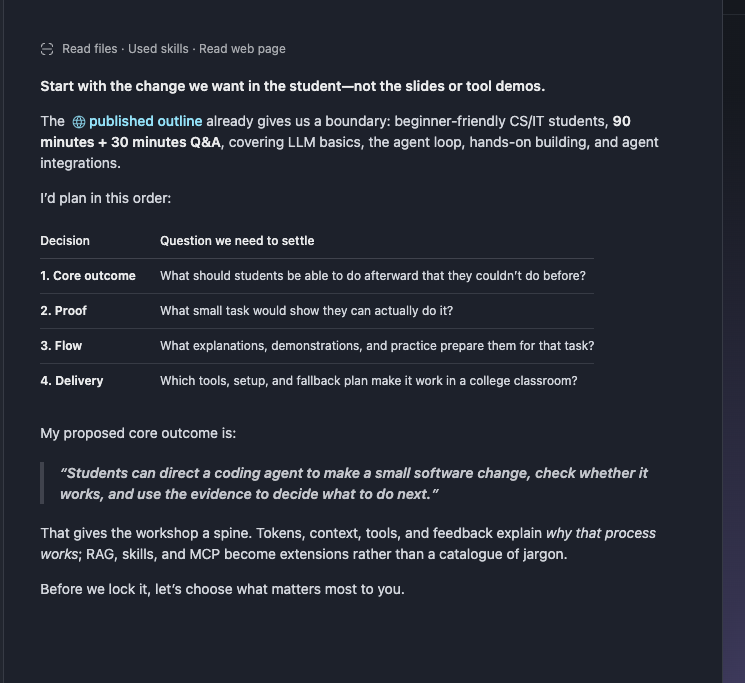
  *(Source: [`/Users/prashantbhudwal/Desktop/Screenshot 2026-10-02 at 17.25.30.png`](file:///Users/prashantbhudwal/Desktop/Screenshot%202026-10-02%20at%2017.25.30.png))*
- DevTools Console 404s (`hibuddy.in`):
  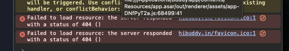
  *(Source: [`/Users/prashantbhudwal/Desktop/Screenshot 2026-10-02 at 17.26.31.png`](file:///Users/prashantbhudwal/Desktop/Screenshot%202026-10-02%20at%2017.26.31.png))*
- DevTools Console 404s Across Multiple Domains (`help.openai.com`, `anthropic.com`, `claude.com`):
  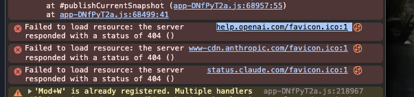
  *(Source: [`/Users/prashantbhudwal/Desktop/Screenshot 2026-10-02 at 17.27.26.png`](file:///Users/prashantbhudwal/Desktop/Screenshot%202026-10-02%20at%2017.27.26.png))*
- Buddy Bench Browser Tab Correctly Showing Favicon:
  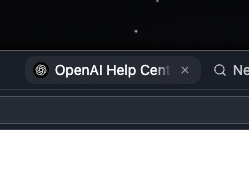
  *(Source: [`/Users/prashantbhudwal/Desktop/Screenshot 2026-10-02 at 17.28.12.png`](file:///Users/prashantbhudwal/Desktop/Screenshot%202026-10-02%20at%2017.28.12.png))*

#### Raw Transcript
```md
/Users/prashantbhudwal/Desktop/Screenshot\ 2026-10-02\ at\ 17.25.30.png this message did not render favicon. /Users/prashantbhudwal/Desktop/Screenshot\ 2026-10-02\ at\ 17.25.30.png
```

```md
dev tools shot /Users/prashantbhudwal/Desktop/Screenshot\ 2026-10-02\ at\ 17.26.31.png updat issue
```

```md
same issue with other faviosn. update issue. on chreom i see the favioc. /Users/prashantbhudwal/Desktop/Screenshot\ 2026-10-02\ at\ 17.27.26.png
```

```md
/Users/prashantbhudwal/Desktop/Screenshot\ 2026-10-02\ at\ 17.28.12.png even our own tabs can show it
```

```md
**Start with the change we want in the student—not the slides or tool demos.**

The [published outline](https://www.hibuddy.in/swe) already gives us a boundary: beginner-friendly CS/IT students, **90 minutes + 30 minutes Q&A**, covering LLM basics, the agent loop, hands-on building, and agent integrations.

I’d plan in this order:

| Decision | Question we need to settle |
|---|---|
| **1. Core outcome** | What should students be able to do afterward that they couldn’t do before? |
| **2. Proof** | What small task would show they can actually do it? |
| **3. Flow** | What explanations, demonstrations, and practice prepare them for that task? |
| **4. Delivery** | Which tools, setup, and fallback plan make it work in a college classroom? |

My proposed core outcome is:

> **Students can direct a coding agent to make a small software change, check whether it works, and use the evidence to decide what to do next.**

That gives the workshop a spine. Tokens, context, tools, and feedback explain *why that process works*; RAG, skills, and MCP become extensions rather than a catalogue of jargon.

Before we lock it, let’s choose what matters most to you.
```

```md
another one on this; just diagnosis first. and ask for proposed fix
```

```md
ask it if this si how t3code does it
```

```md
~/code/t3code
```

```md
Match T3: Google favicon lookup for public hosts (Recommended)
```

```md
markitas done
```

---

### Issue 12: Inconsistent Refresh Icons Between Browser Loading State and App Update Refresh

- **Category:** UX/design proposal / Visual consistency.
- **Tags:** `browser`, `ui`, `icons`, `loading-state`, `design-consistency`, `front-end`
- **Status:**
  - [ ] To do
  - [ ] Doing
  - [x] Done
- **Timestamp:** `2026-10-02 17:30`

#### Context & Problem
Buddy currently displays two different refresh/spinner icon glyphs across related UI surfaces: the icon displayed during the browser loading state does not match the refresh icon used by the app update refresh indicator.

#### Feedback & Suggested Direction
- Standardize on a single canonical refresh icon.
- Replace the browser loading state icon with the same refresh icon used for app update refresh to ensure visual consistency.

#### Raw Transcript
```md
We need to use the same refresh icon that the update refresh uses in the loading state of the browser. Both icons are different
```

```md
put una maz on this
```

```md
for the refresh icon one can you ak the asgent to look for other places where old refresh icon is used and replace it with the new one the one you jsut used for broser
```

```md
mrak this as done
```

---

### Issue 13: Markdown Relative File Links (e.g. `[file.md](file.md)`) Show Pointer Cursor But Fail to Open on Click

- **Category:** Bug candidate.
- **Tags:** `markdown`, `chat`, `ui`, `navigation`, `file-links`, `front-end`
- **Status:**
  - [x] To do
  - [ ] Doing
  - [ ] Done
- **Timestamp:** `2026-10-02 17:35`

#### Context & Problem
When the assistant outputs a markdown link with a relative path (e.g. `[workshop-objectives.md](workshop-objectives.md)`), the text renders with blue link styling and a pointer cursor. However, clicking the link produces no action.

#### Observed Behavior
Clicking `[workshop-objectives.md](workshop-objectives.md)` in the chat message does nothing—the file does not open in Bench, the editor, or the file viewer.

#### Expected Behavior / Improvement Directions
- **Frontend Link Resolution:** The markdown link click handler should resolve relative paths against the active workspace directory and route them to open the target file in the Bench.
- **Prompt Guidance:** In tandem, ensure prompt instructions guide the assistant on whether to output absolute `file:///` URLs, workspace-relative chips, or handle both robustly.

#### Screenshot
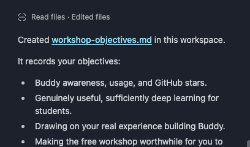
*(Source: [`/Users/prashantbhudwal/Desktop/Screenshot 2026-10-02 at 17.35.04.png`](file:///Users/prashantbhudwal/Desktop/Screenshot%202026-10-02%20at%2017.35.04.png))*

#### Raw Transcript
```md
/Users/prashantbhudwal/Desktop/Screenshot\ 2026-10-02\ at\ 17.35.04.png file linke appears clickable with poiner action but othing happens on click Created **[workshop-objectives.md](workshop-objectives.md)** in this workspace.

It records your objectives:
- Buddy awareness, usage, and GitHub stars.
- Genuinely useful, sufficiently deep learning for students.
- Drawing on your real experience building Buddy.
- Making the free workshop worthwhile for you to deliver.

Using Buddy’s repository is recorded as a **candidate approach**, not a locked decision. My suggested student outcome is separately marked **unapproved**.

I also updated `AGENTS.md:4` so we keep this document current as you make decisions.

maybe this ia proompt issue or a rendring isue. mabybe we shoudld handle relative paths
```

---

### Issue 14: Split View for Tabs in Immersive Mode (Dual Side-by-Side Tabs)

- **Category:** Feature request / UX proposal.
- **Tags:** `bench`, `tabs`, `split-view`, `immersive-mode`, `ui`, `layout`
- **Status:**
  - [x] To do
  - [ ] Doing
  - [ ] Done
- **Timestamp:** `2026-10-02 17:44`

#### Context & Problem
In Bench immersive mode, the workspace currently limits display to a single active tab. When comparing two resources—such as reading documentation alongside an active whiteboard, or cross-referencing notes with a browser page—users are forced to continually switch back and forth between tabs.

#### Feedback & Suggested Direction
- Implement a split-view layout for tabs in immersive mode, allowing 2 tabs to be viewed simultaneously side-by-side.
- Support dual-surface workflows (e.g. two documents, document + browser, or whiteboard + reader) with independent scrolling and interaction.

#### Raw Transcript
```md
need to implement split view in tabs; in immersive mode. bascially 2 tabs at once.
```

---

### Issue 15: Re-evaluate Search Precedence & Item Ranking in Command Palette (`Cmd+P` vs General Search)

- **Category:** UX/design proposal / Search Architecture.
- **Tags:** `command-palette`, `search`, `shortcuts`, `precedence`, `ui`, `front-end`
- **Status:**
  - [x] To do
  - [ ] Doing
  - [ ] Done
- **Timestamp:** `2026-10-02 17:48`

#### Context & Problem
In the unified command palette / quick open (`Search or run a command`, triggered by `Cmd+P`), newly created or modified files (e.g. `workshop-objectives.md`) are buried low in the "Recent" list (5th place), below unrelated whiteboards, chats, and web pages.

#### Feedback & Suggested Direction
- Re-architect search ranking and item precedence:
  - When triggered via `Cmd+P` (traditionally file quick-open), newly created, opened, or modified workspace files should have top precedence.
  - Evaluate whether general command search vs. quick-file-open should use differentiated ranking heuristics or mode-specific filtering so users immediately get the item they expect.

#### Screenshot
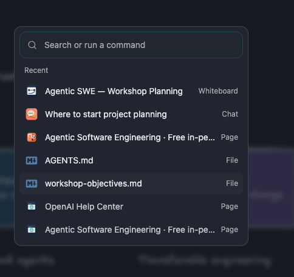
*(Source: [`/Users/prashantbhudwal/Desktop/Screenshot 2026-10-02 at 17.48.04.png`](file:///Users/prashantbhudwal/Desktop/Screenshot%202026-10-02%20at%2017.48.04.png))*

#### Raw Transcript
```md
/Users/prashantbhudwal/Desktop/Screenshot\ 2026-10-02\ at\ 17.48.04.png Here we need to rethink about the precedence of what appears first. Usually when a file is created it should appear first when triggered with command P but maybe in the other search we need to show other things first so we need to think this strategy on how to get this search algorithm going I don't know what the correct answer is but we need to think through this
```

---

### Issue 16: Chat Title Shimmer is Redundant with Sidebar; Restrict Shimmer to Collapsed Sidebar State

- **Category:** UX/design proposal / UI Polish.
- **Tags:** `chat`, `ui`, `loading-state`, `animation`, `shimmer`, `front-end`
- **Status:**
  - [ ] To do
  - [ ] Doing
  - [x] Done
- **Timestamp:** `2026-10-02 18:07`

#### Context & Problem
During turn generation, the chat title in the top bar / header shimmers to indicate an active loading state. Because the left sidebar already displays an active loading indicator for the conversation, shimmering the top title is redundant and visually distracting.

#### Feedback & Suggested Direction
- Stop shimmering the top chat title when the left sidebar is open/expanded.
- Only trigger the title shimmer animation when the left sidebar is collapsed, providing the user with a necessary loading signal only when the sidebar is hidden.

#### Screenshot
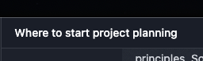
*(Source: [`/Users/prashantbhudwal/Desktop/Screenshot 2026-10-02 at 18.07.39.png`](file:///Users/prashantbhudwal/Desktop/Screenshot%202026-10-02%20at%2018.07.39.png))*

#### Raw Transcript
```md
/Users/prashantbhudwal/Desktop/Screenshot\ 2026-10-02\ at\ 18.07.39.png We flicker the we shimmer the title of the chat when the turn is loading. I think we need to stop doing that because on the left sidebar there is anyway a loading state. I think this loading state of the shimmering of the title of the chart should only happen when the left sidebar is collapsed because otherwise this is very redundant
```

```md
put a sol high to fx this. ask me if you need any input on this. i dont think it does
```

```md
thisis done
```

---

### Issue 17: Reusable Ephemeral Turn Harness for Cache-Preserving Out-of-Band Generations (Notes, Next Prompts, Tasks)

- **Category:** Architecture / LLM Runtime.
- **Tags:** `llm-runtime`, `caching`, `ephemeral-requests`, `architecture`, `back-end`
- **Status:**
  - [x] To do
  - [ ] Doing
  - [ ] Done
- **Timestamp:** `2026-10-02 18:08`
- **Related Issue:** [Issue 05](#issue-05-smart-note-slash-command-with-cache-preserving-ephemeral-draft-generation)

#### Context & Problem
While Issue 05 specified ephemeral out-of-band generation for `/smart-note`, this pattern is needed across several auxiliary capabilities (e.g. suggesting follow-up prompts, generating recommended tasks, quick checks). Currently, there is no generic harness to fire ephemeral queries off the current conversation history without polluting session persistence or breaking prompt prefix caches.

#### Feedback & Suggested Direction
- Create a dedicated, reusable harness in the runtime/session layer for sending one-off, out-of-band model requests from any arbitrary point in the chat.
- **Cache Preservation:** Send the current conversation history as the prefix so provider prompt caching remains intact.
- **Non-Persisted Execution:** Ensure these one-off requests and their responses are completely bypass-isolated from the session message store.
- **Modular Consumers:** Expose this harness for `/smart-note`, recommended next actions, follow-up prompt chips, and other auxiliary assistive features.

#### Raw Transcript
```md
Also regarding that note feature that where I said that we need to generate one of notes without breaking a cache, I think that needs to be a reusable kind of a part of code. So if we want to generate one of things like let's say recommended tasks or next possible prompts or so on without breaking the cache of the code we can do that once we have that kind of a harness ready of sending one of messages from a given point in the chat without saving them
```

---

### Issue 18: Rate Limit and Runtime Error Banners Above Composer Cannot Be Dismissed

- **Category:** UX/design proposal / Error Recovery.
- **Tags:** `chat`, `composer`, `errors`, `rate-limits`, `ui`, `front-end`
- **Status:**
  - [x] To do
  - [ ] Doing
  - [ ] Done
- **Timestamp:** `2026-10-02 18:15`
- **Triage:** Deferred by user on 2026-10-03 after rejecting the Easel design. Diagnosis and preview retained; no production behavior changed.

#### Context & Problem
When a rate limit is reached (e.g. "ChatGPT Plus limit reached") or other runtime errors fire, a prominent error card is docked directly above the prompt composer. The card only provides a "Details" button, with no dismiss (`✕`) or hide control.

#### Observed Behavior
Once the rate limit banner appears above the prompt composer, there is no way for the user to hide or dismiss it. It permanently blocks vertical chat space even if the user switches models or chooses to wait.

#### Feedback & Suggested Direction
- Provide a clear dismiss / close (`✕`) button on the rate limit banner and similar error cards docked above the composer.
- Ensure all persistent status/error cards can be dismissed or minimized once acknowledged by the user.

#### Screenshot
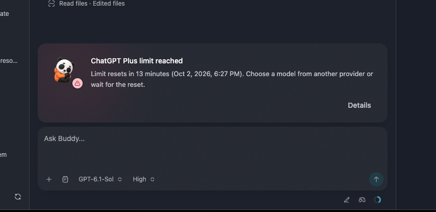
*(Source: [`/Users/prashantbhudwal/Desktop/Screenshot 2026-10-02 at 18.15.18.png`](file:///Users/prashantbhudwal/Desktop/Screenshot%202026-10-02%20at%2018.15.18.png))*

#### Raw Transcript
```md
/Users/prashantbhudwal/Desktop/Screenshot\ 2026-10-02\ at\ 18.15.18.png We get this rate limit errors when the rate limit runs out maybe similar other errors we also get, similar other errors we also get. But there is no way to hide this message once this appears. So it might be useful to hide this once it appears. I mean give the users the ability to hide this
```

```md
suggest which errors need dismiss buttons. use sol high for diagnosis
```

```md
ask it to demo this on easel
```

```md
defer the error disimissalfor nto due to horrible desing implementian on easel
```

---

### Issue 19: Rate Limit Banner Persists Stale Error After Switching to an Account/Provider with Available Quota

- **Category:** Bug candidate / State Management.
- **Tags:** `chat`, `composer`, `rate-limits`, `accounts`, `providers`, `state-management`, `ui`, `front-end`
- **Status:**
  - [x] To do
  - [ ] Doing
  - [ ] Done
- **Timestamp:** `2026-10-02 18:19`
- **Related Issue:** [Issue 18](#issue-18-rate-limit-and-runtime-error-banners-above-composer-cannot-be-dismissed)

#### Context & Problem
When a rate limit is reached on one account/provider, the error banner advises: *"Choose a model from another provider or wait for the reset."* However, when the user switches to a different account/provider that has plenty of quota remaining (e.g. 62% used of 5-hour limit, 30% of 7-day limit), the banner fails to refresh or clear.

#### Observed Behavior
Even after switching to an account with remaining quota, the docked banner continues displaying `ChatGPT Plus limit reached - Limit resets in 9 minutes...`. The banner is tied to stale provider state rather than reacting to the newly active account/model.

#### Expected Behavior
- The rate limit banner state should reactively re-evaluate whenever the user switches models, accounts, or providers.
- If the newly active provider has valid quota, automatically clear the rate limit banner (or update it to the active provider's status).

#### Screenshot
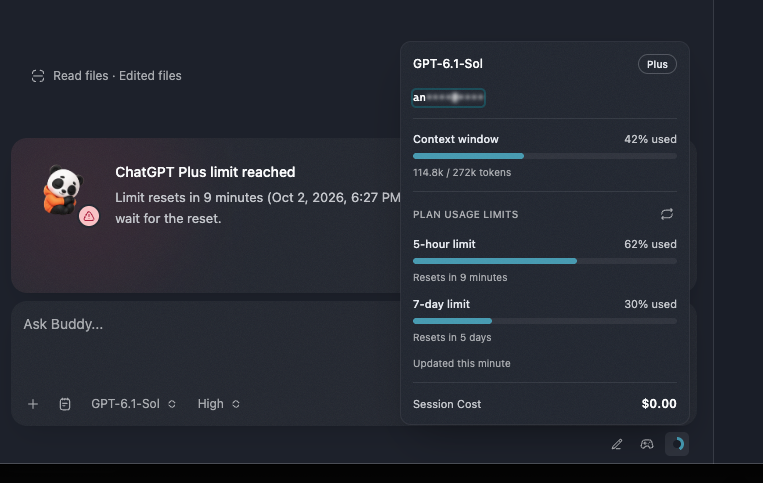
*(Source: [`/Users/prashantbhudwal/Desktop/Screenshot 2026-10-02 at 18.19.19.png`](file:///Users/prashantbhudwal/Desktop/Screenshot%202026-10-02%20at%2018.19.19.png))*

#### Raw Transcript
```md
Also notice this what I did was I changed the provider agent after I hit the rate limit. So I moved from agent A to agent B now the banner still appears that your rate limit will reset in 9 minutes but the provider has changed and that has limits so we might need to you know refresh this if the provider switches/Users/prashantbhudwal/Desktop/Screenshot\ 2026-10-02\ at\ 18.19.19.png
```

---

### Issue 20: Model Selector Lacks Fast Mode for ChatGPT Models (Coordinate with Easel Redesign)

- **Category:** Feature request / UX proposal.
- **Tags:** `models`, `model-selector`, `fast-mode`, `chatgpt`, `easel`, `ui`, `front-end`
- **Status:**
  - [x] To do
  - [ ] Doing
  - [ ] Done
- **Timestamp:** `2026-10-02 18:25`

#### Context & Problem
Buddy's model selector currently offers no way to enable or select fast mode for ChatGPT models. Prototype work on an improved model selector is actively underway in DevTools Easel (`packages/web/src/components/debug/easel/model-selector/`).

#### Feedback & Suggested Direction
- Incorporate fast mode selection/toggling for ChatGPT models into the Easel model selector prototype and subsequent production picker.
- Give users an explicit, discoverable control to toggle fast mode on supported models rather than ambiguous labeling.

#### Raw Transcript
```md
Buddy model selector does not show fast mode for chat GPT models. I think we already have a model selector work going on in the easel. So we need to ensure that we are able to add fast mode somehow there
```

---

### Issue 21: Markdown Editor Tables Over-Constrained by Prose Readable Width; Allow Wide Table Breakout

- **Category:** UX/design proposal / Typography & Layout.
- **Tags:** `markdown`, `bench`, `editor`, `tables`, `layout`, `typography`, `ui`, `front-end`
- **Status:**
  - [x] To do
  - [ ] Doing
  - [ ] Done
- **Timestamp:** `2026-10-02 18:45`

#### Context & Problem
In the Bench Markdown editor and reader view, content width is uniformly constrained to a narrow readable prose column. While appropriate for body text, forcing multi-column markdown tables into this narrow width causes severe column cramping and awkward word fragmentation (e.g. `Elap/sed/time`, `Foregroun/d section`, `Durati/on`), despite abundant horizontal space in the Bench.

#### Feedback & Suggested Direction
- Decouple table width from the prose text column limit.
- Allow tables to break out and expand across the full available viewport width in the Bench.
- Individual column max-widths can be constrained for readability if needed, but the table element itself should utilize available container width to prevent unnecessary line wrapping.

#### Screenshot
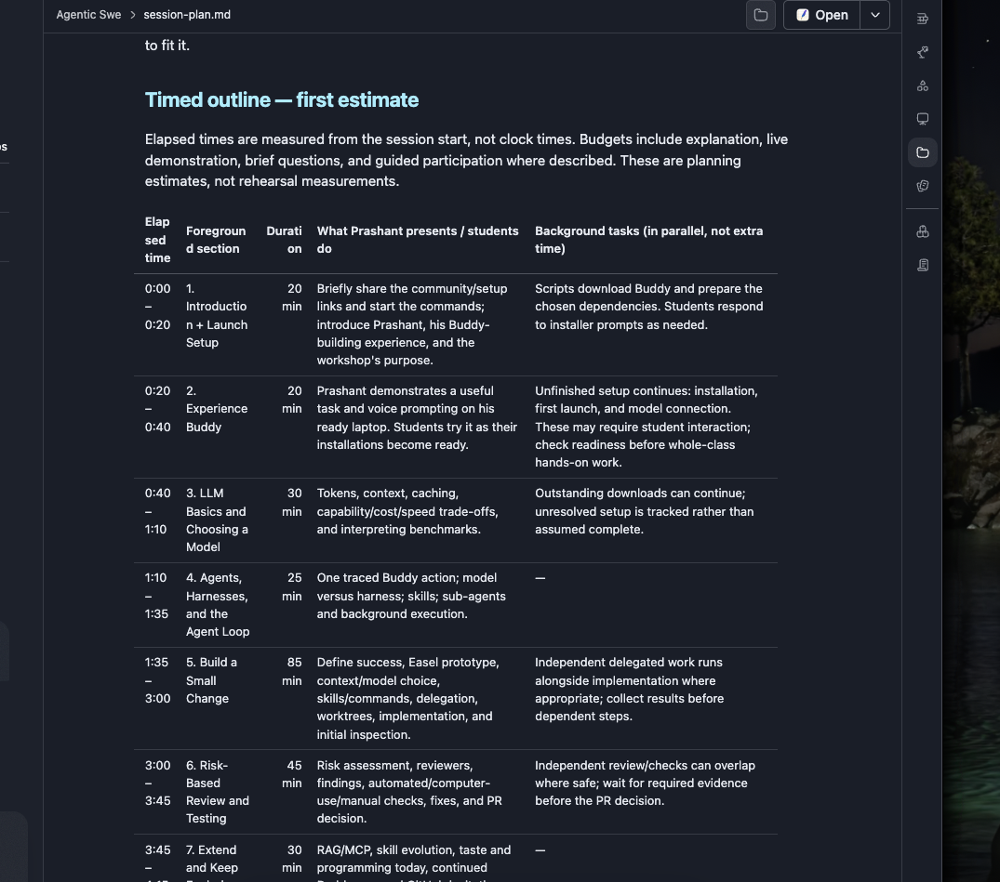
*(Source: [`/Users/prashantbhudwal/Desktop/Screenshot 2026-10-02 at 18.45.19.png`](file:///Users/prashantbhudwal/Desktop/Screenshot%202026-10-02%20at%2018.45.19.png))*

#### Raw Transcript
```md
/Users/prashantbhudwal/Desktop/Screenshot\ 2026-10-02\ at\ 18.45.19.png In our markdown editor we have constrained the width of the text to the readable width that is great but I don't think we need to do the same for a table I think table can span much wider because in it it will have multiple columns and those columns can contain text that is not so the column inside the text inside the columns can be constrained to readable width if we have to or the max width of each column can be constrained to the readable width but the whole table we don't need to we can expand as much width that we have
```

---

### Issue 22: Label All Edit-Tool Activity as "Creating"

- **Category:** UX/design proposal / Copy & Status Accuracy.
- **Tags:** `chat`, `tool-activity`, `ui`, `labels`, `front-end`
- **Status:**
  - [ ] To do
  - [ ] Doing
  - [x] Done
- **Timestamp:** `2026-10-02 19:02`

#### Context & Problem
In the turn activity/progress rows (above the assistant message alongside "Thought for Xs"), file writing tools currently display a generic `[✏️] Editing` status badge. When the agent is creating a brand-new file or new file patch, labeling the action "Editing" is inaccurate.

#### Feedback & Suggested Direction
- Latest clarification: all edit tools should say "Creating", including modifications to existing files.
- First inventory the edit tools and their activity-labeling paths; propose the exact labels to change before implementation.

#### Raw Transcript
```md
We need to change this editing text to creating for file edits and file patches and all that /Users/prashantbhudwal/Desktop/Screenshot\ 2026-10-02\ at\ 19.02.34.png
```

```md
this is not what i want; i want all edit ttools to say creating.  can you gell me which edit tools exist and which we should change to creating
```

```md
sol high
```

```md
The three native file tools (Recommended)
```

```md
Created; use Creating while running (Recommended)
```

```md
i did not fucking want crateing files. only fucking creating
```

```md
diy
```

```md
mark this done
```

---

### Issue 23: Use `task-daily-01` Icon for "Updated Tasks" Activity in Chat Transcript

- **Category:** UX/design proposal / Iconography.
- **Tags:** `chat`, `tool-activity`, `tasks`, `icons`, `hugeicons`, `ui`, `front-end`
- **Status:**
  - [ ] To do
  - [ ] Doing
  - [x] Done
- **Timestamp:** `2026-10-02 19:04`

#### Context & Problem
In the chat transcript progress/activity rows (above assistant responses), when tasks are created or updated (e.g. `Updated tasks`), Buddy currently renders a generic bulleted list icon.

#### Feedback & Suggested Direction
- Replace the generic list icon with the `task-daily-01` Hugeicon (`TaskDaily01Icon` from `@hugeicons/react`) for `Updated tasks` and related task-tracking status rows in the chat transcript.

#### Raw Transcript
```md
task-daily-01 And I think we need to use this icon for the updated tasks or tasks UI in the chat transcript
```

```md
put luna max on this
```

```md
mark as done
```

---

### Issue 24: File Icons Across UI Suffer from Low Contrast and Are Nearly Unreadable in Light Mode

- **Category:** Bug candidate / Contrast & Accessibility.
- **Tags:** `theme`, `light-mode`, `contrast`, `accessibility`, `file-icons`, `tabs`, `ui`, `front-end`
- **Status:**
  - [ ] To do
  - [ ] Doing
  - [x] Done
- **Timestamp:** `2026-10-02 20:17`

#### Context & Problem
In light mode, file type icons (such as the markdown `[M↓]` badge) across the UI (e.g. Bench tabs, file chips, and explorer rows) suffer from poor contrast. The pale blue badge background and light glyph elements wash out against the light theme background, making the icons nearly invisible and difficult to distinguish.

#### Observed Behavior
- **Bench Tabs:** Under light mode, file icons appear washed out with insufficient contrast ratio against the surrounding tab surface and internal white glyphs.
- **Chat Transcript Inline Chips:** Inline file chips (e.g. `[M↓ target.md]`, `[M↓ target with spaces.md]`) also render with washed-out, illegible file badges where the white Markdown icon details disappear against the light-blue fill inside light grey pills.

#### Expected Behavior & Solution Direction
- **Mode-Specific Color Palettes:** The root cause is that the markdown icon was specifically styled/optimized for dark mode, leading to low contrast on light backgrounds.
- Icon colors must dynamically adapt based on the active theme mode (light vs. dark), using deeper fills/borders or inverted glyph strokes in light mode so that badges remain legible in all themes.

#### Screenshots
- Bench Tabs (Washed Out Icons):
  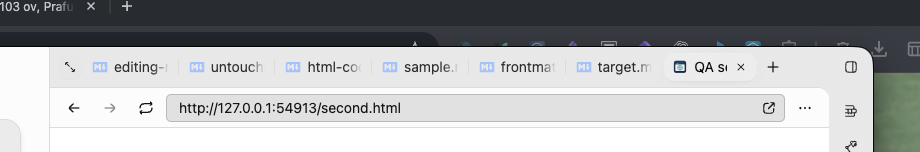
  *(Source: [`/Users/prashantbhudwal/Desktop/Screenshot 2026-10-02 at 20.17.06.png`](file:///Users/prashantbhudwal/Desktop/Screenshot%202026-10-02%20at%2020.17.06.png))*
- Chat Transcript Inline Chips (Illegible Badge Fills):
  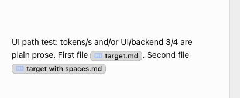
  *(Source: [`/Users/prashantbhudwal/Desktop/Screenshot 2026-10-02 at 20.31.31.png`](file:///Users/prashantbhudwal/Desktop/Screenshot%202026-10-02%20at%2020.31.31.png))*

- Chat file-chip layout regression after the approved color change:
  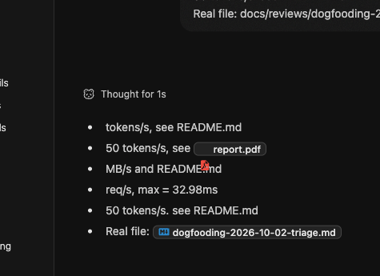
  Source: `/var/folders/6b/_tpzqtks48d18kr7zb8w4t800000gn/T/TemporaryItems/NSIRD_screencaptureui_WPItM0/Screenshot 2026-10-03 at 03.27.25.png`.

#### Raw Transcript
```md
/Users/prashantbhudwal/Desktop/Screenshot\ 2026-10-02\ at\ 20.17.06.png In light mode the file icons everywhere are almost unreadable
```

```md
/Users/prashantbhudwal/Desktop/Screenshot\ 2026-10-02\ at\ 20.31.31.png/Users/prashantbhudwal/Desktop/Screenshot\ 2026-10-02\ at\ 20.31.31.png Another example of file icons not rendering in the chat transcript also update the previous task about this
```

```md
I think the major issue here is because we optimize the markdown icon for dark mode it is fucked up for light mode so we might need to switch the colors based on modes
```

```md
ask sol high ot show me before and after of this on easel. sample a few icons based on thier color
```

```md
after are fucing worse in contrast on dardk than before. they are better on ligt byt by wrecking dark. ask it to fix
```

```md
the icons  colors ar fine now; ask it do implement in prod
```

```md
make md icon of same brightness in dark mode as ts icon
```

```md
wha the fuck happene here? iwh report icons
```

---

### Issue 25: Whiteboard Empty State Card is Too Large; Redesign for a More Minimal Footprint

- **Category:** UX/design proposal / Component Sizing & Polish.
- **Tags:** `chat`, `empty-state`, `whiteboard`, `ui`, `design`, `front-end`
- **Status:**
  - [x] To do
  - [ ] Doing
  - [ ] Done
- **Timestamp:** `2026-10-02 20:18`

#### Context & Problem
The new chat empty state fixture—styled as a textured whiteboard card featuring a corner date bracket, large "What are we learning?" typography, and the 3D panda mascot—has grown too large.
In docked side-by-side mode, it consumes nearly the entire vertical height above the composer, crowding the initial interaction area.

#### Feedback & Suggested Direction
- Make the empty state fixture significantly more minimal and compact.
- Preserve the signature tactile feeling (the whiteboard grain, corner date cue, and welcoming tone), but scale down the overall dimensions, typography, and mascot so the empty state stays unobtrusive and lightweight.

#### Screenshots
- Docked Chat View (Heavy Vertical Footprint):
  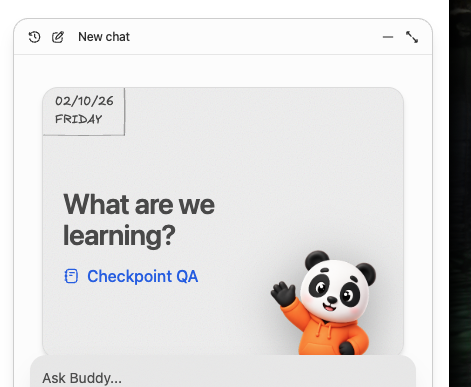
  *(Source: [`/Users/prashantbhudwal/Desktop/Screenshot 2026-10-02 at 20.18.37.png`](file:///Users/prashantbhudwal/Desktop/Screenshot%202026-10-02%20at%2020.18.37.png))*
- Expanded Chat View:
  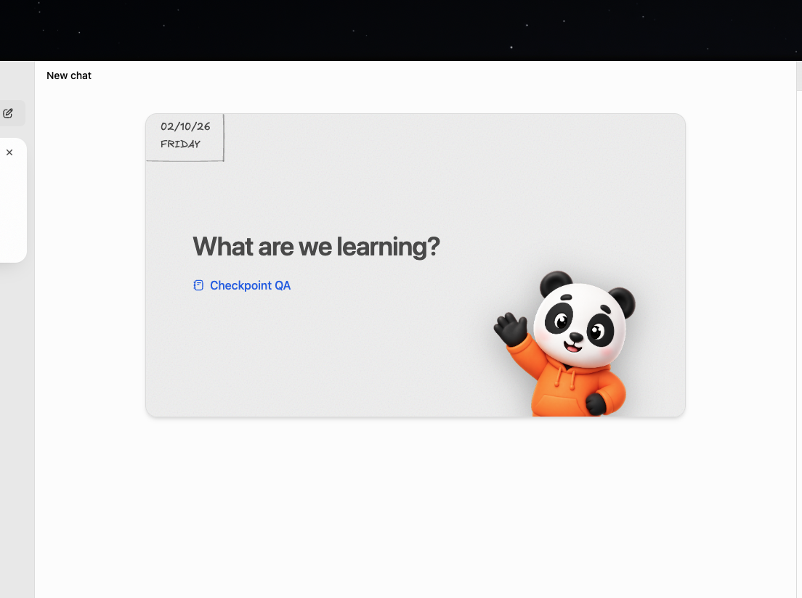
  *(Source: [`/Users/prashantbhudwal/Desktop/Screenshot 2026-10-02 at 20.18.56.png`](file:///Users/prashantbhudwal/Desktop/Screenshot%202026-10-02%20at%2020.18.56.png))*

#### Raw Transcript
```md
/Users/prashantbhudwal/Desktop/Screenshot\ 2026-10-02\ at\ 20.18.37.png /Users/prashantbhudwal/Desktop/Screenshot\ 2026-10-02\ at\ 20.18.56.png These whiteboard fixtures are I mean the fix I mean this empty state fixtures that look like whiteboard that have the grain are too big now we need to figure out a way to maintain the feel of this the feeling of this but make this make these fixtures more minimal
```

---

### Issue 26: No Proactive Warning When Subscription Approaches Plan Limits (OpenAI Codex Provider)

- **Category:** UX/design proposal / Rate Limit Awareness.
- **Tags:** `chat`, `rate-limits`, `usage`, `openai`, `codex-provider`, `composer`, `ui`, `front-end`
- **Status:**
  - [x] To do
  - [ ] Doing
  - [ ] Done
- **Timestamp:** `2026-10-03 00:17`

#### Context & Problem
For the OpenAI Codex / ChatGPT Plus provider, Buddy tracks usage windows (e.g. 5-hour limit and 7-day limit in the model popover). However, when a subscription is close to reaching its ceiling (e.g. 85%+ used), Buddy provides no proactive warning or indicator anywhere in the main UI. Users are caught by surprise when a turn abruptly hits a hard rate limit block.

#### Feedback & Suggested Direction
- Implement a near-limit warning state when plan usage approaches threshold capacity.
- Explore subtle visual affordances before the hard block hits:
  - Meter bar color changes (e.g. teal → amber/red) in the usage popover.
  - A subtle indicator or tooltip near the model picker / composer footer alerting the user that the subscription is nearly exhausted.
- Gives users advance notice to pace their prompts, finish critical steps, or switch models/providers proactively.

#### Raw Transcript
```md
when the sub is close to the limit; we show no warning to the user anywhere. need to find a wayfor this. this is for openai codex provider.
```

---

### Issue 27: Native Table of Contents (TOC) View for Markdown/MDX Reader (Like Book Reader)

- **Category:** Feature request / UX proposal.
- **Tags:** `bench`, `markdown`, `reader`, `toc`, `navigation`, `ui`, `front-end`
- **Status:**
  - [ ] To do
  - [ ] Doing
  - [x] Done
- **Timestamp:** `2026-10-03 00:36`

#### Context & Problem
Buddy's book reader features a dedicated Table of Contents (TOC) for navigating chapters and headings. However, the Markdown/MDX document reader on Bench lacks any native TOC. For structured or lengthy markdown files (e.g. `workshop-objectives.md`), users have to manually author navigation lists or scroll extensively to locate sections.

#### Feedback & Suggested Direction
- Implement a native Table of Contents view/drawer for the Markdown and MDX reader on Bench, mirroring the TOC experience in the book reader.
- Automatically extract `#`, `##`, and `###` heading hierarchy into a clickable outline with section jumping and scroll spy indicator.

#### Triage Follow-up — 2026-10-03
- Keep TOC authoring separate from Issue 28's navigation repair; they remain related work items.
- Implemented the selected native book-style Contents popover in production Markdown/MDX Bench surfaces, including read-only presented files. It nests headings, highlights the current section, follows edits and external replacements, and closes after selection. Easel uses the production heading controller; docked/wide and one/no-heading examples remain available.
- Verification: 79 focused navigation, editor, Bench and shared reader tests pass; root lint and typecheck pass. Live-app verification remains pending.

#### Screenshot
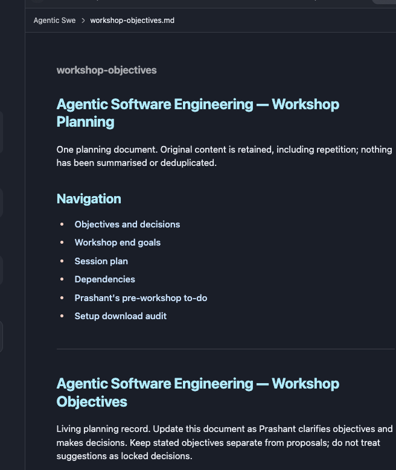
*(Source: [`/Users/prashantbhudwal/Desktop/Screenshot 2026-10-03 at 00.36.48.png`](file:///Users/prashantbhudwal/Desktop/Screenshot%202026-10-03%20at%2000.36.48.png))*

#### Raw Transcript
```md
need a toc view like we have for booksfor mdx reader too. /Users/prashantbhudwal/Desktop/Screenshot\ 2026-10-03\ at\ 00.36.48.png
```

```md
lets start woking on markdonw heading naviation and toc. first navigation. find the cuase andpropose  fix
```

```md
also porpose toc ui on easel for native ones. 
```

```md
book style pop over
```

```md
these are kind of two related fiffernt issues. 
```

```md
you fuck did you make th code changes/
```

```md
makehte fuckign prod changes
```

---

### Issue 28: In-Document Markdown Anchor Links (`#heading`) Fail to Navigate to Target Sections

- **Category:** Bug candidate / Navigation.
- **Tags:** `bench`, `markdown`, `reader`, `editor`, `anchor-links`, `navigation`, `ui`, `front-end`
- **Status:**
  - [ ] To do
  - [ ] Doing
  - [x] Done
- **Timestamp:** `2026-10-03 00:38`
- **Related Issue:** [Issue 27](#issue-27-native-table-of-contents-toc-view-for-markdownmdx-reader-like-book-reader)

#### Context & Problem
When markdown documents include internal anchor links to headings (e.g. `[Session plan](#agentic-software-engineering-...)`), clicking the link does not jump or scroll the viewport to the target section. Instead, an editor link popover (`#anchor... [edit] [copy] [unlink]`) is presented, leaving the user unable to navigate through in-page anchor links.

#### Observed Behavior
Clicking `Session plan` (pointing to `#agentic-software-engineering-...`) triggers the link inspection popover without navigating or scrolling the document to the corresponding heading anchor.

#### Expected Behavior
- Clicking in-document anchor links (`#...`) in reader mode should smoothly scroll the viewport directly to the target heading.
- Ordinary clicks jump to the heading. Edit links through the toolbar, as selected during triage on 2026-10-03.

#### Triage Follow-up — 2026-10-03
- Navigation diagnosis and repair are separate from Issue 27's TOC UI.
- Confirmed cause: fragment lookup missed punctuation-based heading slugs and duplicate-heading suffixes. The original screenshot's exact instance remains unverified.
- Previously, link clicks forwarded to Bench navigation, whose already-open policy ignored repeated target/fragment requests.
- Implemented unique Markdown heading slugs while preserving explicit IDs and Obsidian heading/block anchors. Every same-document click scrolls the document viewport directly and prevents pointer selection from opening the link inspection popover. Link editing remains available through the toolbar.
- Verification: 79 focused tests, root lint and typecheck pass; regressions assert actual repeated Markdown/MDX heading jumps, duplicate targets, source preservation and live outline updates. Live-app verification remains pending.
- [Concise production change record](markdown-heading-navigation-proposal-2026-10-03.md).

#### Screenshot
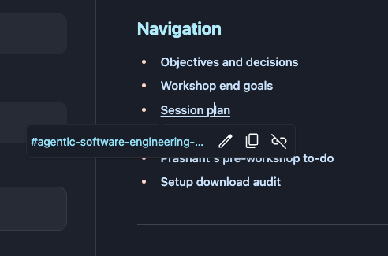
*(Source: [`/Users/prashantbhudwal/Desktop/Screenshot 2026-10-03 at 00.38.05.png`](file:///Users/prashantbhudwal/Desktop/Screenshot%202026-10-03%20at%2000.38.05.png))*

#### Raw Transcript
```md
/Users/prashantbhudwal/Desktop/Screenshot\ 2026-10-03\ at\ 00.38.05.png also this navigation in mdx reader foes not work
```

```md
lets start woking on markdonw heading naviation and toc. first navigation. find the cuase andpropose  fix
```

```md
these are kind of two related fiffernt issues. 
```

```md
Jump to the heading; edit through the toolbar
```

```md
you fuck did you make th code changes/
```

```md
makehte fuckign prod changes
```

---

### Issue 29: Consolidate Separator-Tolerant Matching Across All Search Surfaces

- **Category:** Architecture / Search consistency.
- **Tags:** `search`, `notes`, `skills`, `command-palette`, `chat`, `front-end`, `back-end`
- **Status:**
  - [x] To do
  - [ ] Doing
  - [ ] Done
- **Timestamp:** `2026-10-03 00:56`
- **Related Issue:** [Issue 15](#issue-15-re-evaluate-search-precedence--item-ranking-in-command-palette-cmdp-vs-general-search)

#### Context & Problem
The notes change on `fix/notes-ux` makes notes search treat `snake case`, `snakecase`, `SnakeCase` and `snake_case` as the same identifier, and keeps underscores readable in previews and quote headings. That rule lives only in the notes server code. Buddy's other search boxes each match in their own way, so the same query behaves differently depending on where it is typed. This issue tracks giving every search one shared separator rule, as a follow-up after the notes change ships on its own.

#### Observed Behavior
Read from the code on 2026-10-03; not reproduced in the running app.

| You type | Looking for | Notes (after the notes change) | Shared scorer | Plain "contains" filters |
|---|---|---|---|---|
| `snake case` | `snake_case` | Found | Found | Missed |
| `snakecase` | `snake_case` | Found | Found, ranked last | Missed |
| `snake_case` | `SnakeCase` or `snake-case` | Found | Missed | Missed |

- **Notes:** `separatorTolerantSearchPattern` in `packages/buddy/src/notes/library.ts`.
- **Shared scorer:** `scoreNotebookSearchText` in `packages/web/src/state/notebook-search.ts` and `rankNotebookFilePaths` in `packages/web/src/state/notebook-file-ranking.ts`. Used by file search, Bench search, quick open, the composer's `@` file picker, and the Sources, Boards, Practice and Creations filters. A typed `_` or `-` must match literally.
- **Plain "contains" filters:** the Skills drawer (`right-workspace-skills-drawer.tsx`, `skill-presentation.ts`), slash-command autocomplete, `@` mention autocomplete for agents and references, the notebook picker (`routes/chat.tsx`), the font and MCP pickers in Settings, and the agent's Bench tab search (`packages/buddy/src/learning/features/bench/model-tabs.ts`).
- **Same class of bug in preview text:** `cleanReasoningHeading` in `packages/web/src/components/chat/utils/markdown.ts` strips every underscore, so a reasoning label mentioning `snake_case` shows `snakecase`.

#### Expected Behavior & Direction
- One separator rule in a place both the server and the web client can import, with notes, the shared scorer and the plain filters all using it.
- Reasoning labels keep underscores inside identifiers, as notes previews now do.
- **Sequencing:** do this after the notes change merges. The notes change is server-only and complete on its own; this follow-up changes matching and ranking in about a dozen surfaces at once and needs its own review.
- **Open decision:** where a separator-folded match ranks in the shared scorer. Proposed: below an exact substring match, above the letters-in-order fallback. Coordinate with the ranking rethink in Issue 15.
- **Open decision:** the Skills filter would move from exact-text matching to ranked matching, which may surface more results than today.
- **Estimated size:** roughly 9 source files and 5 test files, plus about six one-line call sites for the plain filters. Estimated from reading the code, not from attempting the change.

#### Raw Transcript
```md
tell me this thre is this  change. we are fiing this for notes. do we need to also fix this for evyering else; or should i just raise pr with this. before starting your work. or should we consolidate this first

Find identifiers and read accurate quote headings
Where: Notes search, result previews and chat quotes saved into notes.

You do	Before	After
Search for an identifier	snake case could miss snake_case.	snake case, snakecase, SnakeCase and snake_case find the same identifier. Works for filenames too.
Read a preview or quote heading	snake_case could become snakecase; a code language label could appear as content.	Underscores, paths and code text remain readable. Fence labels such as python disappear from the excerpt.
Reopen Buddy with older chat notes	Previously generated broken quote headings stayed broken.	Recognized old generated headings repair automatically at startup. Custom headings and the quoted body stay as written.
```

```md
how big is thsi if we decide to consolidat?
```

```md
i dont understnd wont we need to do this for all search everywherer?
```

```md
i have cleaned up the tree significantly. you sure we should wrap this up first
```

```md
add the issue for later consolidatoin here.   • Current Session File (Issues & Transcripts):
  dogfooding-2026-10-02.md
```


