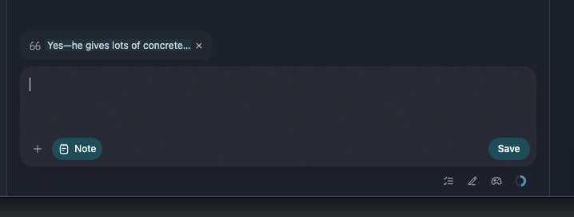
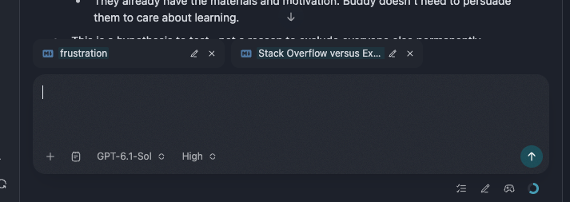
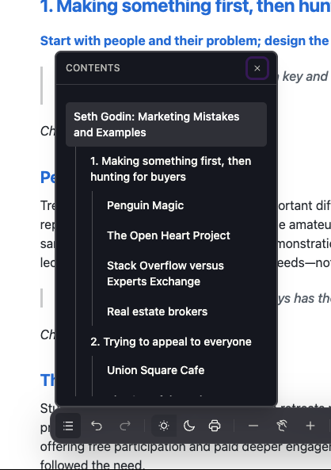
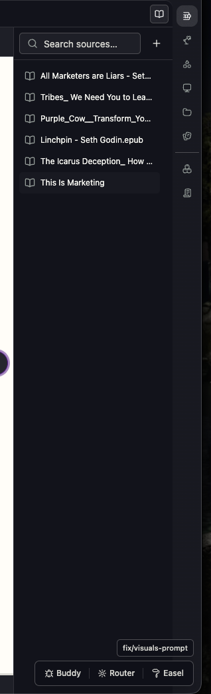
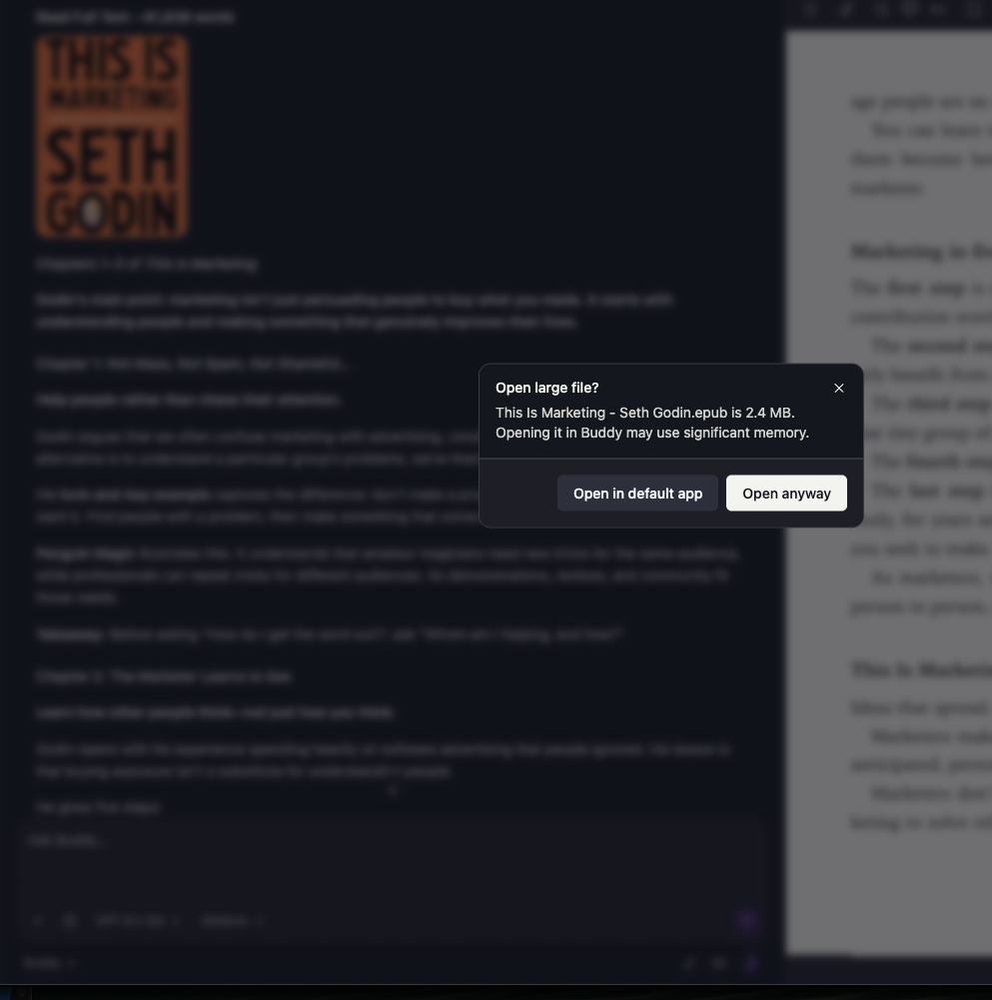
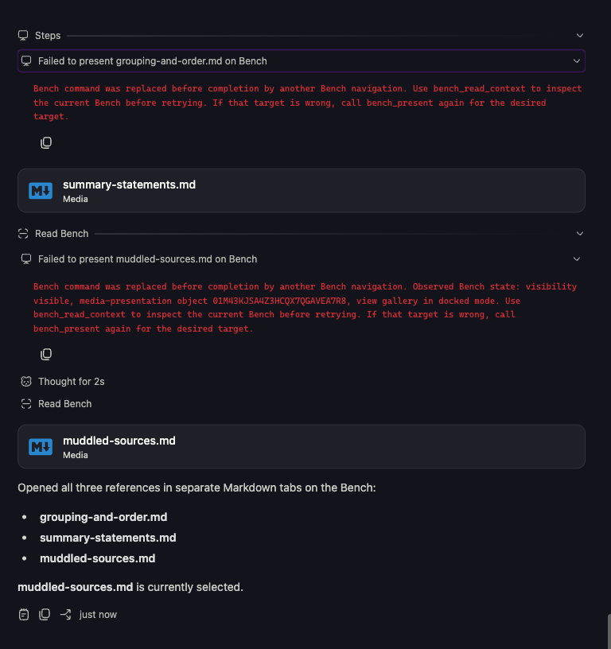
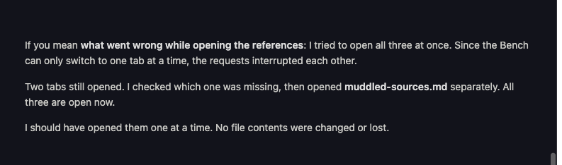
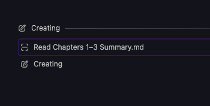

# Dogfooding Session - October 4, 2026

Observations reported while using Buddy during the October 4, 2026 dogfooding session.

---

## Session Guidelines & Reference

- **Guidelines & Intake Protocol:** Documented in [`docs/reviews/AGENTS.md`](AGENTS.md).
- **Previous Session & Triage:**
  - Active backlog and deferred items: [`docs/reviews/dogfooding-2026-10-02-triage.md`](dogfooding-2026-10-02-triage.md).
  - Completed items awaiting review: [`docs/reviews/to-review-2026-10-03.md`](to-review-2026-10-03.md).
  - Prior intake log & full transcripts: [`docs/reviews/dogfooding-2026-10-02.md`](dogfooding-2026-10-02.md).
- **Core Rules:**
  1. Record problems faithfully from user verbal/written accounts while using the running app.
  2. **Strictly No Cause Interpretation:** Do not interpret causes, theorize technical roots, or inspect code during intake. Just document what is observed, and mark unknowns as unknown.
  3. **Verbatim Transcript Preservation:** Every reported issue must preserve the user's exact raw message verbatim in a `#### Raw Transcript` block.
  4. Keep issues atomic, non-nested, and clearly categorized.

---

## Issues & Transcripts

### Issue 01: Modal Flicker and Severe Layout Shift During New Notebook Creation

- **Category:** Bug candidate / UX & Layout Stability.
- **Tags:** `notebook`, `creation`, `modal`, `layout-shift`, `flicker`, `ui`, `front-end`
- **Status:**
  - [x] To do
  - [ ] Doing
  - [ ] Done
- **Timestamp:** `2026-10-04 13:54`

#### Context & Problem
During the notebook creation flow, triggering creation causes an abrupt visual flicker in the creation modal accompanied by a heavy layout shift across the UI.

#### Observed Behavior
When creating a new notebook, the modal flickers and the interface undergoes a jarring layout jump rather than transitioning cleanly into the newly created notebook workspace.

#### Expected Behavior
Notebook creation should be visually stable and fluid: the dialog and underlying layout should transition without unmount flicker, sudden repositioning, or jarring layout shifts.

#### Raw Transcript
```md
when creating a new notebook there is a modal flicker and a huge layout shift - this is not normal. need to assess the system again.
```

---

### Issue 02: Streaming Nested List Bullets Start at Margin and Flicker Inward (Layout Shift)

- **Category:** Bug candidate / Streaming Markdown Rendering & Layout Shift.
- **Tags:** `markdown`, `streaming`, `chat`, `lists`, `nested-lists`, `layout-shift`, `flicker`, `ui`, `front-end`
- **Status:**
  - [x] To do
  - [ ] Doing
  - [ ] Done
- **Timestamp:** `2026-10-04 14:18`

#### Context & Problem
While an agent generates a nested list during streaming responses, each new item bullet marker initially renders at the start of a new line (unindented margin) before snapping/flickering to its intended indented position.

#### Observed Behavior
When an agent creates nested lists during streaming generation, as each new item marker starts (such as before items 6, 7, 8 in list hierarchies), the marker initially starts flush at the beginning of the line, then flickers and indents inside. This causes repeated layout shift on bullets whenever they are created.

#### Expected Behavior
Streaming list items and bullets should render with stable positioning from the start of generation, without flickering from the line margin into an indented position.

#### Raw Transcript
```md
I asked the agent to create a nested list and every time a new list icon startups I don't mean the nested one I mean the main icon for example that is in front of the number 678 and so on it startups at the beginning of a new line and then flickers to be indented inside so there's a layout shift of the top level bullets whenever it is created

- **The central mistake: starting with your need to sell, rather than their reason to care.**
  - In *This Is Marketing*, Godin’s other warnings largely follow from this.
  - Here’s my synthesis of his main warnings—not a numbered list he gives in the book:
    - **1. Make a product, then hunt for buyers.**
      - **Why it fails:** You’re trying to persuade people to want something you’ve already decided to make.
      - **Instead:** Start with particular people, their problem, and the change they want.
      - *Chapters 1 and 6.*
    - **2. Try to appeal to everyone.**
      - **Why it fails:** You remove distinctive qualities to avoid rejection—and make something nobody especially cares about.
      - **Instead:** Serve the smallest viable market deeply. Accept that “It’s not for you” is sometimes the right answer.
      - *Chapter 4.*
    - **3. Assume customers think like you—or choose purely rationally.**
      - **Why it fails:** Your idea of “better” may not match their beliefs, fears, identity, or priorities.
      - **Instead:** Understand their worldview rather than treating disagreement as ignorance.
      - *Chapters 3 and 5.*
    - **4. Sell features instead of outcomes.**
      - **Why it fails:** People care less about what you made than about what it will do for them.
      - **Instead:** Connect the product to practical progress and feelings such as confidence, belonging, or security.
      - *Chapters 3 and 7.*
    - **5. Confuse attention with trust.**
      - **Why it fails:** Clicks, followers, interruptions, and hype don’t automatically produce belief or commitment.
      - **Instead:** Earn permission, make honest promises, and build trust through actions.
      - *Chapters 17–18.*
    - **6. Expect promotion to rescue an ordinary offering.**
      - **Why it fails:** Advertising can’t reliably turn something people feel indifferent about into something they love and share.
      - **Instead:** Build a reason to care—and a reason to talk—into the experience itself.
      - *Chapters 8 and 17.*
      - **Nuance:** Advertising can work. He treats it as an optional engine for growth, not a substitute for good marketing.
    - **7. Compete mainly by being cheaper.**
      - **Why it fails:** You become interchangeable and lose the margin needed to deliver something better.
      - **Instead:** Offer a meaningful difference to people who value it.
      - *Chapter 16.*
    - **8. Quit or change direction too soon.**
      - **Why it fails:** You get bored with your message before the audience has absorbed it or learned to trust you.
      - **Instead:** Show up consistently. Change tactics when needed without constantly abandoning the strategy.
      - *Chapters 15 and 20.*
```

---

### Issue 03: Pending Steering Message Can Show Age Before Its Turn Settles

- **Category:** Bug candidate / Chat message lifecycle.
- **Tags:** `chat`, `steering`, `message-age`, `ui`, `front-end`
- **Status:**
  - [x] To do
  - [ ] Doing
  - [ ] Done
- **Disposition:** Deferred by user; accepted for the current PR stack. Revisit if it causes a real problem.
- **Timestamp:** `2026-10-04 14:20`
- **Related Issue:** [Issue 06: last-message elapsed time](to-review-2026-10-03.md#issue-06-show-how-long-ago-the-last-message-was-sent).

#### Context & Problem
Sol extra-high review of the elapsed-time change identified a pending-steer edge case. The user considers it nonblocking and explicitly authorized raising candidates 1–5 without fixing it.

#### Observed Behavior
Code-review finding, not a live-app observation: when a user sends a steer while the preceding assistant turn is still streaming, the latest user-only turn is not marked active even though the session is busy. Its hover/focus age can appear before settlement, then disappear when active ownership transfers to that turn. No real-app reproduction has been recorded here.

#### Expected Behavior & Direction
If this becomes disruptive, revisit whether elapsed-time visibility should wait for session settlement. Reviewer identified the fallback at `packages/web/src/components/chat/chat-timeline-rows.ts:428`; existing steering fixture at `packages/web/test/chat-timeline-rows.test.ts:310`. No implementation change requested now.

#### Screenshots
None recorded; finding came from static review.

#### Raw Transcript
```md
Yeah, that P2 is a non-issue for now. It gives if it gives me a problem I will solve it later document it as a dog fooding issue along with the other issues and continue raising the stack 1 to 5
```

---

### Issue 04: Add "New Document" Action to Create Markdown Files Inside Notebook (Distinct from "New Note")

- **Category:** Feature / UX & Notebook Workspace
- **Tags:** `notebook`, `document`, `markdown`, `notes`, `actions`, `ui`, `front-end`
- **Status:**
  - [x] To do
  - [ ] Doing
  - [ ] Done
- **Timestamp:** `2026-10-04 14:25`

#### Context & Problem
"New note" creates files outside of the notebook. There is currently no action to create a new markdown file inside the notebook.

#### Observed Behavior
Creating a note places it outside the notebook. There is no dedicated action to create a new markdown document directly inside the notebook.

#### Expected Behavior
Add a "New document" action that creates a new markdown file directly inside the notebook.

#### Raw Transcript
```md
need to add a new document action; that creates new md file int he notebook. new note creates it out of hte notebook.
```

---

### Issue 05: Note Saved Without Quote Should Not Be Placed in Quote Block

- **Category:** UX/design proposal / Notes Capture & Formatting
- **Tags:** `notes`, `chat`, `quote`, `markdown`, `formatting`, `ui`
- **Status:**
  - [x] To do
  - [ ] Doing
  - [ ] Done
- **Timestamp:** `2026-10-04 14:31`

#### Context & Problem
When capturing a note from chat without an attached quote (or if the quote chip is dismissed), placing the user's note inside a markdown blockquote (`> ...`) is inappropriate because nothing is being quoted.

#### Observed Behavior
When saving a note without a quote, the note is still placed in a quote block structure.

#### Expected Behavior & Direction
If a user saves a note without a quote, do not wrap it in a quote block. Consider using standard paragraph text or an alternative visual marker/callout syntax suitable for standalone user thoughts.

#### Screenshots

*Original path: `/Users/prashantbhudwal/Desktop/Screenshot 2026-10-04 at 14.30.40.png`*

#### Raw Transcript
```md
if user saves the note without quote, there is no need to add it in a quote block, is it? maybe we can use another marker./Users/prashantbhudwal/Desktop/Screenshot 2026-10-04 at 14.30.40.png
```

---

### Issue 06: Add Transcript Bottom Fade/Shadow Effect Matching Top Header

- **Category:** UX/design proposal / UI Polish & Transcript Presentation
- **Tags:** `chat`, `transcript`, `scroll`, `shadow`, `visual-polish`, `ui`, `front-end`
- **Status:**
  - [x] To do
  - [ ] Doing
  - [ ] Done
- **Timestamp:** `2026-10-04 15:40`

#### Context & Problem
In the chat view, content scrolling down toward the input composer and resource attachment shelf cuts off without a gradual transition or depth cue. The top of the transcript has a shadow/gradient fade effect, but the bottom area above the composer does not mirror it.

#### Observed Behavior
Messages scrolling past the bottom of the visible transcript area meet the prompt box and resource chips without a matching shadow or gradient mask, causing harsh cutoffs and visual friction.

#### Expected Behavior & Direction
Add the same shadow/gradient fade effect to the bottom of the transcript area (above the prompt composer and resource chip shelf) as is currently used at the top of the transcript, creating balanced depth and smooth scroll containment.

#### Screenshots

*Original path: `/Users/prashantbhudwal/Desktop/Screenshot 2026-10-04 at 15.40.19.png`*

#### Raw Transcript
```md
need to add the same shadow affect as on the top of hte transcript /Users/prashantbhudwal/Desktop/Screenshot 2026-10-04 at 15.40.19.png
```

---

### Issue 07: Relocate Markdown Table of Contents from Bottom Bar to Top Left Header

- **Category:** UX/design proposal / Bench & Markdown Reader Navigation
- **Tags:** `markdown`, `toc`, `bench`, `navigation`, `breadcrumbs`, `ui-layout`, `ui`, `front-end`
- **Status:**
  - [x] To do
  - [ ] Doing
  - [ ] Done
- **Timestamp:** `2026-10-04 17:09`

#### Context & Problem
The Table of Contents (TOC) for markdown documents currently resides as a popover button on the floating bottom toolbar. Placing document navigation at the bottom is awkward for reading flow, and the user prefers having it accessible from the top left corner (e.g. near or after the breadcrumbs header).

#### Observed Behavior
TOC popover is currently triggered from the bottom toolbar, opening upwards over the markdown document text.

#### Expected Behavior & Direction
Move the Table of Contents trigger to the top-left area of the markdown document view (potentially near or immediately after the breadcrumbs). Layout and exact positioning to be finalized via design discussion.

#### Screenshots

*Original path: `/Users/prashantbhudwal/Desktop/Screenshot 2026-10-04 at 17.08.42.png`*

#### Raw Transcript
```md
Also I need to move the table of contents of the markdown from the bottom bar to the top left corner. I don't know where to make the space for it right now. Maybe it's near the breadcrumbs, maybe it's after the breadcrumbs. I'll have to do a design discussion with Claude regarding this. So yeah/Users/prashantbhudwal/Desktop/Screenshot 2026-10-04 at 17.08.42.png
ga
```

---

### Issue 08: Style Sources / Books Drawer to Look Like a Library

- **Category:** UX/design proposal / Drawer Presentation & Visual Identity
- **Tags:** `sources`, `books`, `reading`, `drawer`, `library`, `visual-polish`, `ui`, `front-end`
- **Status:**
  - [x] To do
  - [ ] Doing
  - [ ] Done
- **Timestamp:** `2026-10-04 17:36`

#### Context & Problem
The Sources / Books drawer currently presents books and resources as a generic vertical list of plain text rows with a line-art book icon, lacking warmth, visual depth, and the feeling of a curated personal reading library.

#### Observed Behavior
Resources appear in a basic narrow file-list format with truncated filenames and monotone icons.

#### Expected Behavior & Direction
Redesign the drawer presentation so it actually feels like a library (e.g. book covers, shelf-like layout, spine styling, or richer card representations) rather than a utilitarian file explorer.

#### Screenshots

*Original path: `/Users/prashantbhudwal/Desktop/Screenshot 2026-10-04 at 17.36.28.png`*

#### Raw Transcript
```md
need to make this drawre look like a library /Users/prashantbhudwal/Desktop/Screenshot 2026-10-04 at 17.36.28.png
```

---

### Issue 09: Erroneous "Open Large File?" Warning Modal When Clicking Inline Book Link

- **Category:** Bug candidate & Architecture / File Handling & Reading Resources
- **Tags:** `epub`, `reader`, `inline-reference`, `bench`, `large-files`, `modal`, `file-viewer`, `architecture`, `ui`
- **Status:**
  - [x] To do
  - [ ] Doing
  - [ ] Done
- **Timestamp:** `2026-10-04 19:26`

#### Context & Problem
When clicking an inline reference to an EPUB book from chat, the system shows an "Open large file?" modal: *"This Is Marketing - Seth Godin.epub is 2.4 MB. Opening it in Buddy may use significant memory."* The book is already open on the Bench on the right.

#### Observed Behavior
Clicking an inline book reference prompts an "Open large file?" confirmation dialog for a 2.4 MB `.epub` file that is already actively open and rendered on the Bench.

#### Expected Behavior & Direction
Clicking an inline book should not trigger a large-file warning, particularly when the resource is already open on the Bench. The large file strategy needs to be rethought.

#### Screenshots

*Original path: `/Users/prashantbhudwal/Desktop/Screenshot 2026-10-04 at 19.25.32.png`*

#### Raw Transcript
```md
This appears when I click an inline book makes no sense because memory management is done by the EPAP reader already I think and the resource is already open on the right side now I don't understand like why are we getting this error we need to rethink the large file strategy that we have /Users/prashantbhudwal/Desktop/Screenshot 2026-10-04 at 19.25.32.png
```

---

### Issue 10: Failed Bench Presentation: "Bench command was replaced before completion by another Bench navigation"

- **Category:** Bug candidate / Bench
- **Tags:** `bench`, `bench_present`, `tool-step`, `error`, `chat`
- **Status:**
  - [x] To do
  - [ ] Doing
  - [ ] Done
- **Timestamp:** `2026-10-04 19:34`
- **Chat ID:** `ses_ef9409e54ffeS7bO1xbgm8ZTY8` (in dev db)

#### Context & Problem
In chat session `ses_ef9409e54ffeS7bO1xbgm8ZTY8`, tool steps attempting to present files to the Bench fail with:
> *"Bench command was replaced before completion by another Bench navigation. Use bench_read_context to inspect the current Bench before retrying. If that target is wrong, call bench_present again for the desired target."*

#### Observed Behavior
Tool steps in the timeline show red error banners: *"Failed to present grouping-and-order.md on Bench"* and *"Failed to present muddled-sources.md on Bench"*. In the chat response, the agent noted: *"I tried to open all three at once. Since the Bench can only switch to one tab at a time, the requests interrupted each other."*

#### Expected Behavior
Presenting items on Bench should succeed without triggering replacement errors or failed tool step banners.

#### Screenshots

*Original path: `/Users/prashantbhudwal/Desktop/Screenshot 2026-10-04 at 19.33.40.png`*


*Original path: `/Users/prashantbhudwal/Desktop/Screenshot 2026-10-04 at 19.37.09.png`*

#### Raw Transcript
```md
this bench bug needs to be resolved /Users/prashantbhudwal/Desktop/Screenshot 2026-10-04 at 19.33.40.png chat id: ses_ef9409e54ffeS7bO1xbgm8ZTY8 thhis is in dev db
```

```md
/Users/prashantbhudwal/Desktop/Screenshot 2026-10-04 at 19.37.09.png add this to the issue.
```

---

### Issue 11: File Read Tool Step is Not Clickable to Open File

- **Category:** UX/design proposal / Chat & Tool Steps
- **Tags:** `chat`, `tool-step`, `read-file`, `bench`, `navigation`, `ui`, `front-end`
- **Status:**
  - [x] To do
  - [ ] Doing
  - [ ] Done
- **Timestamp:** `2026-10-04 19:42`

#### Context & Problem
When the agent executes a tool step that reads a file (e.g., `Read Chapters 1–3 Summary.md`), the tool step row in the timeline cannot be clicked to open the file.

#### Observed Behavior
Clicking the `Read <filename>` tool step does not open the referenced file.

#### Expected Behavior
Users should be able to click on the tool step or file name that the agent just read to open that file directly. Note: The created action already has this click-to-open behavior; read file actions just need to extend that existing pattern.

#### Screenshots

*Original path: `/Users/prashantbhudwal/Desktop/Screenshot 2026-10-04 at 19.42.10.png`*

#### Raw Transcript
```md
/Users/prashantbhudwal/Desktop/Screenshot 2026-10-04 at 19.42.10.png i should be able to click and open the file the agent just read
```

```md
cereadted action already has this, we just need to extend that
```


