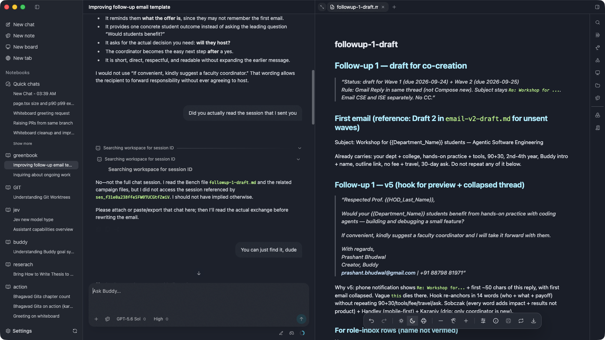

# Dogfooding Feedback

Observations reported while using Buddy. The issue descriptions preserve the user's experience and ideas; triage findings appear separately below.

## 2026-09-23

### Issue 01: Co-create skill for learners and teachers

- **Category:** Feature request.
- **Context:** While creating a document with Buddy, a learner or teacher may want to make something together with the agent, such as a research report.
- **Feedback:** Bundle a `co-create` skill with Buddy to guide this collaborative workflow. Buddy has several ways to work with content, including the reader, writer, and Bench, but needs a coherent way to choose and introduce the right one for the user's goal.
- **Suggested experience:** When someone asks to create something together, Buddy chooses the best creation modality, makes the document or other artifact, places it on the Bench, and explains that it is ready to co-create and how the person can interact with it. The skill should guide Buddy in helping the learner or teacher through the creation process.

### Issue 03: Right rail and right workspace need a clearer pattern

- **Category:** Mixed — bug candidate for the new-chat behavior; UX/design proposal for the rail and empty state.
- **Observed behavior:** The right rail feels disorganized. Items have unclear scope: some apply across notebooks, some belong to the current notebook, and a skill file appears there. The right sidebar/workspace feels limited to searching sources.
- **New chat behavior:** Opening a new chat can show an apparently unrelated page in the right workspace when a workspace was already open.
- **Feedback:** Define a clearer, more organized pattern for the right rail and the right sidebar/workspace.
- **Suggested empty state:** Use a simple search field, similar to the existing search pattern, where someone can search for content, enter a URL, or take other available actions when nothing is open.

### Issue 04: General Sonar placement

- **Category:** UX/design proposal.
- **Observation:** General Sonar currently sits at the bottom right. Moving it to the top right may be worth considering.
- **Open question:** Understand the pros and cons of each placement before deciding. This is not an implementation task yet.

### Issue 08: Successful resource processing may need a clearer follow-up

- **Category:** UX/design proposal.
- **Observed behavior:** When the prepared-resource tool processes a resource successfully, the result is shown in the transcript.
- **Open question:** Consider whether Buddy should also make the processed resource easier to find or act on, using the note-taking pattern where taking a new note triggers a sidebar response as a possible reference.
- **Possible directions:** Show a Sonar, open the library, or provide another follow-up. The desired behavior is undecided.

### Issue 10: Enter inserts a citation instead of sending the message

- **Category:** UX/design proposal for a separate send shortcut; the reported Enter behavior needs interaction context before treating it as a malfunction.
- **Observed behavior:** In the citation flow, pressing Enter adds the citation to the message.
- **Suggested shortcut:** Consider a separate shortcut, such as Command+Enter, to send the message directly to the agent.

### Issue 12: Reading skill needs a broad update

- **Category:** Feature request.
- **Current limitation:** The skill tells the agent to ingest a book, a pattern that may not work well when the user is working with multiple books.
- **Feedback:** The reading skill feels incomplete and too primitive, and does not account for newer surfaces such as Whiteboard and Browser.
- **Suggested direction:** Refactor and update the reading skill broadly to cover these workflows and capabilities.

### Issue 13: Calibre library support may need a skill

- **Category:** Feature request.
- **Current limitation:** Buddy does not have a skill for working with a Calibre library.
- **Feedback:** Calibre is a tool many learners use, similar to Archive, and CLI-based library workflows should be part of the Buddy system.
- **Suggested direction:** Consider adding a Calibre library skill.

### Issue 14: Review external agent skill sources for useful additions

- **Category:** Research task.
- **Feedback:** Revisit skill sources in the `agentic` folder, including Hermes and other agents, to identify useful skills Buddy may be missing.
- **Context:** These sources keep updating their skills, so the review may need to account for changes over time.

### Issue 18: Consider a YOLO or full-access permission mode

- **Category:** Feature request.
- **Idea:** Consider adding a Buddy mode that grants broad access across folders, similar to T3 Code's YOLO mode.
- **Status:** This is a proposal to consider, not a decided implementation.

### Issue 19: Help Buddy find its other sessions

- **Category:** Feature request.
- **Idea:** Add a Buddy Help skill that can identify the user's other Buddy sessions from details they provide, such as a session ID or title.

### Issue 20: Session-search activity is duplicated and persists after completion

- **Category:** Bug candidate.
- **Observed behavior:** After a turn completes, the thinking block can show the activity title “Searching workspace for session ID” instead of a duration summary such as “Thought for X seconds.” The same activity appears three times: twice as rows and once as the expanded title.
- **Feedback:** Avoid the repeated activity entries and show the completed turn's thinking duration summary.
- **Screenshot:** 

### Issue 22: Fast-mode control and labeling

- **Category:** UX/design proposal.
- **Feedback:** Do not label all GPT-5 or GPT-6 models as fast. Explore a toggle or other control for enabling fast mode, and make that mode clear in Buddy.
