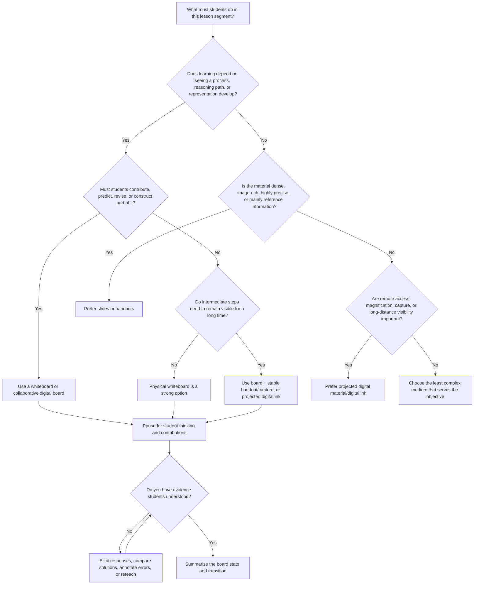

# Evidence-Based Guidance for When and How Instructors Should Use a Whiteboard

## Executive summary

The research does **not** support a simple conclusion that “whiteboards are better than slides,” or vice versa. The stronger conclusion is that the instructional medium should be selected to fit the **learning process required by the objective**. University course-design guidance explicitly recommends starting from measurable learning outcomes and then selecting teaching strategies and assessment methods that serve those outcomes, rather than treating a particular medium as inherently desirable. citeturn17view10

A physical whiteboard is most defensible when students benefit from seeing **knowledge being constructed over time**: a worked example, mathematical derivation, causal chain, diagram, concept map, timeline assembled from evidence, or a solution that needs to change in response to student questions. This recommendation is supported indirectly—but strongly—by cognitive-load research on worked examples and segmentation. Sweller's work shows that conventional problem solving can consume working-memory resources that would otherwise support schema acquisition, while subsequent research on transient information shows that information disappearing before learners adequately process it can impair learning. citeturn17view7turn20search9 The implication is not “write slowly because slow is good”; it is **reveal the structure at the rate at which learners can process the structure, while retaining relevant intermediate states long enough to use them**.

Whiteboards are also particularly useful as **participation surfaces rather than presentation surfaces**. UCLA explicitly recommends whiteboards for small-group concept mapping and asks students to explain the relationships they created; Berkeley recommends whiteboards or large chart paper for gallery walks in which groups construct, display, critique, and revise responses. Harvard Project Zero's Think-Pair-Share guidance similarly recommends giving learners time to think and discuss before whole-class sharing and suggests documenting and displaying student ideas. citeturn17view1turn17view0turn17view3 This use is consistent with the much broader evidence for active learning: large-scale STEM evidence finds better learning under active-learning designs than traditional lecture, and a later individual-participant-data meta-analysis found that sufficiently intensive active learning reduced achievement gaps in exam scores and passing rates. Those studies establish the value of **active cognitive work**, not a special causal benefit of dry-erase markers. citeturn17view4turn22view1

Conversely, a physical board is a poor default when the objective requires **high visual fidelity, dense reference information, precise images, accessibility through magnification or assistive technology, reliable distribution after class, or equal visibility for remote learners**. Columbia's HyFlex guidance specifically warns that a physical chalkboard/whiteboard must be visible to remote students and recommends a projected device-and-stylus alternative when appropriate. citeturn0search2 Digital content also has accessibility advantages when designed to accessibility standards, because it can support assistive technologies and alternative presentation; W3C's accessibility guidance provides the relevant standards framework. citeturn21search6turn21search19

The direct empirical literature comparing chalkboard/whiteboard teaching with PowerPoint is much weaker than the general learning-science literature. For example, Jose et al. studied 149 second-year medical students receiving two pharmacology lectures from the same teacher and reported higher immediate post-test scores after the blackboard lecture even though more students *preferred* PowerPoint. Because topic was tied to presentation condition and the study was not a randomized, counterbalanced modality trial, the result cannot establish that the board itself caused superior learning. It does, however, demonstrate an important methodological point: **student preference and measured learning need not agree**. citeturn22view2

Accordingly, the most evidence-aligned policy is:

**Use a physical whiteboard when the instructional value comes from construction, sequencing, adaptation, or shared student thinking. Use slides or handouts when the value comes from precision, permanence, density, or advance preparation. Use projected digital ink when you need board-like construction plus visibility, distribution, or remote access. Combine media when their functions genuinely differ rather than duplicating the same information across them.** This is a synthesis of the cited evidence rather than a finding from a single whiteboard experiment. citeturn17view7turn20search9turn17view0turn17view1turn0search2

## Evidence base and decision principles

### Start with the learning objective, not the equipment

A useful first question is not “Should I use the whiteboard?” but **“What observable performance should students be able to produce by the end of this segment?”** DePaul University's Teaching Commons describes learning outcomes as student-centered, measurable statements of what learners will be able to do and explicitly notes that outcomes should guide teaching strategies, materials, and assessments. It also cautions against defining an outcome in terms of the assignment format itself. citeturn17view10

That leads to a modality-to-objective mapping:

| Intended student performance | Whiteboard implication |
|---|---|
| **Explain a process or justify each step** | Strong case for sequential board construction, especially if intermediate steps matter. |
| **Solve a novel problem** | Use the board first for a worked or partially worked example, then shift cognitive work to students rather than continuing instructor demonstration indefinitely. |
| **Interpret a diagram or model relationships** | Build or annotate the representation progressively; invite students to propose connections. |
| **Recall facts or consult a dense reference** | Usually weak case for live board transcription; a handout or stable slide is more efficient and more permanent. |
| **Compare multiple complex artifacts or high-resolution images** | Slides, handouts, or digital projection generally have a functional advantage. |
| **Generate, organize, or challenge ideas** | Strong whiteboard case because the board can become a shared external representation of student thinking. |
| **Demonstrate mastery individually** | The board can elicit a small sample of thinking, but individual response systems, written work, or quizzes usually provide broader evidence across the class. |

This table is a decision synthesis from backward-design guidance, cognitive-load research, and university active-learning guidance rather than a claim that each row has been tested in a direct whiteboard-versus-alternative randomized trial. citeturn17view10turn17view7turn17view1

### Treat the board as an external working memory

The strongest psychological rationale for a board is that it can make an evolving structure externally visible. Sweller's cognitive-load work argued that means-ends problem solving can demand substantial cognitive processing while failing to direct sufficient resources toward schema acquisition; the worked-example literature consequently supports showing novices organized solution procedures rather than requiring unguided solution generation from the outset. citeturn17view7 Sweller and Cooper's algebra experiments are a foundational direct demonstration of the worked-example effect in novice learning. The original paper is *Cognition and Instruction*, 2, 59–89, DOI: `10.1207/s1532690xci0201_3`. citeturn5search4

This favors a whiteboard for a derivation such as

\[
\text{problem representation}
\rightarrow
\text{principle}
\rightarrow
\text{substitution}
\rightarrow
\text{transformation}
\rightarrow
\text{interpretation},
\]

because instructor and students can refer back to the preceding states. But the benefit disappears if those states are erased before students have processed them. Singh, Marcus, and Ayres experimentally demonstrated a **transient-information effect**: information that disappears before adequate processing can yield poorer learning than permanent information, and segmentation into smaller units improved learning. Their experiments also found an advantage for persistent written text over otherwise identical transient spoken information. citeturn20search9

The practical implication is therefore more precise than “board writing slows the instructor down”: **segment, retain, and connect**. Write one meaningful unit, explain it, connect it to the previous unit, obtain evidence that students are following, and only then advance. Preserve definitions, diagrams, assumptions, or earlier equations that later reasoning depends upon. When the physical board is too small to preserve those dependencies, a handout or persistent digital canvas may be cognitively preferable. citeturn20search9

### Apply multimedia principles functionally

Multimedia learning does not imply that adding more media automatically improves learning. The relevant design issue is whether visual and verbal information help learners construct an integrated representation without unnecessary search, redundancy, or transience. Research cited in the instructional literature includes Mayer and Anderson's experimental work on coordinating words and pictures in multimedia explanation, while cognitive-load studies emphasize limited processing capacity and the consequences of transient information. citeturn22view2turn17view7turn20search9

For board teaching, the defensible applications are:

- **Segment rather than dump:** construct a multi-step representation in meaningful chunks. citeturn20search9
- **Coordinate speech with the visual step it explains:** do not finish a complicated diagram and then deliver a disconnected verbal explanation of earlier elements.
- **Do not turn the board into a transcript:** writing paragraphs while speaking different material can create competing demands; use the board for structure, relationships, equations, key terms, or student-generated ideas rather than everything that is said. This recommendation follows from cognitive-load constraints rather than from evidence that handwriting itself is beneficial. citeturn17view7turn20search9
- **Preserve dependencies:** if Step 7 requires comparison with Steps 2 and 4, keep those available or reproduce them in a stable handout/digital view. citeturn20search9

## Decision flowchart

The key branch is **process versus product**. The board is most distinctive when process visibility or shared construction is pedagogically valuable; slides and handouts have advantages when students principally need an accurate, stable product. The later branches incorporate the transient-information evidence, university guidance on collaborative board use, and Columbia's guidance that physical boards can become problematic when remote learners cannot see them. citeturn20search9turn17view0turn17view1turn0search2

## Matching whiteboard use to content and lesson timing

### Worked examples and derivations

For novice learners facing a complex procedure, begin with a **worked example or partially worked example**, not an immediate demand that every student discover the solution strategy independently. Sweller's research attributes part of the advantage of worked examples to reducing cognitive processing spent on unproductive means-ends search and allowing more capacity for schema acquisition. citeturn17view7turn5search4

A good board sequence is:

**problem → known information → principle → first transformation → pause/prediction → next transformation → interpretation → student attempt at a near-transfer problem.**

The board is therefore valuable in the **modeling phase**, but should not monopolize the entire lesson. Once learners have enough structure, responsibility should shift from instructor-generated board work toward student generation and practice. The broader evidence for active learning strongly favors such student cognitive activity over uninterrupted exposition. citeturn17view4turn22view1

A useful transition point is when students can answer questions such as “What operation should come next, and why?” or “Which principle licenses this step?” At that moment, stop writing and elicit a prediction. The prediction—not the instructor's hand movement—is the learning activity.

### Diagrams, concept maps, and causal models

Whiteboards have unusually strong affordances when the representation itself is under construction: adding an arrow, moving a boundary, labeling a feedback loop, correcting a misconception, or juxtaposing alternative models. UCLA explicitly recommends briefly modeling a concept map on a whiteboard and notes that small groups can use multiple classroom whiteboards to represent their ideas, followed by student explanations of the connections they made. citeturn17view1

This suggests a three-stage pattern:

**instructor model → student/group construction → whole-class comparison and refinement.**

For a finished anatomical image, complex map, micrograph, data visualization, artwork, or other high-fidelity artifact, projection is normally the better source image; the board's role can then be **annotation** rather than reproduction. That distinction follows from objective alignment: do not spend instructional time redrawing something whose exact appearance is itself the information students need.

### Timelines and sequences

A board can be useful for a timeline when students need to understand **relations among events**, not merely memorize dates. Begin with a stable axis or a few anchors, then let evidence, causes, consequences, and competing interpretations accumulate around them. This uses the board as a spatial model and keeps earlier items available for comparison, consistent with the importance of information permanence identified by transient-information research. citeturn20search9

When the timeline contains many dates or requires exact wording, give students a handout or digital reference as well. Asking students simultaneously to copy a dense timeline and follow an oral argument risks turning the board into a transcription bottleneck rather than a reasoning aid; the permanence evidence argues for retaining stable reference material separately when necessary. citeturn20search9

### Brainstorming and synthesis

Brainstorming is a strong whiteboard use when the objective is to **externalize the class's conceptual space**. UCLA suggests spending roughly the opening portion of a concept-map activity generating critical concepts with students and then using the map to make relationships visible. Berkeley's gallery-walk model has small groups create responses on whiteboards or chart paper, circulate among displays, and add thoughts, comments, or questions before groups reconsider their work. citeturn17view1turn17view0

The important distinction is between **recording contributions** and **organizing contributions**. A board filled chronologically with whatever students say may merely preserve talk. A pedagogically stronger board clusters, connects, contrasts, or labels contributions so that students can see the emerging disciplinary structure.

### Formative assessment

A whiteboard becomes a formative-assessment tool only if what appears on it changes the instructor's next decision. Ask students to complete a step, sketch a model, rank alternatives, add evidence, diagnose an intentionally incorrect derivation, or compare two competing solutions. Berkeley's gallery-walk design explicitly incorporates peer comments and questions, while UCLA's concept-map guidance asks students to explain their connections and encourages instructor follow-up questions for elaboration. citeturn17view0turn17view1

Whole-class board work nevertheless has a sampling problem: one student writing at the front does not show what the other 99 students know. In large classes, pair the board with simultaneous individual or pair responses—paper work, polling, short written retrieval, or Think-Pair-Share—before asking one solution to be placed on the board. Harvard's Think-Pair-Share routine deliberately inserts individual thinking before peer discussion and public sharing, reducing reliance on the first volunteer's answer. citeturn17view3

### When to switch to and away from the board

There is no evidence-based universal rule such as “use the board after 15 minutes.” Timing should be **event-triggered rather than clock-triggered**. The evidence supports switching **to** the board when one of four events occurs: the class needs to see a reasoning sequence unfold; the instructor needs to adapt an explanation to a student question; students need a shared surface on which to generate or compare thinking; or a complex explanation needs to be segmented into manageable states. citeturn17view7turn20search9turn17view1

Switch **away** from it when the purpose changes: students now need independent practice; the content becomes primarily stable reference information; accurate/high-resolution visuals matter more than construction; all useful board space is occupied by information that still needs to remain visible; or physical visibility prevents a substantial portion of the class from accessing the representation. citeturn20search9turn0search2

A particularly effective transition is:

> **Explain → stop → think → pair → elicit → write/annotate → check → summarize.**

Harvard Project Zero describes Think-Pair-Share as a routine for active reasoning and explanation and specifically notes that it can be inserted in the **middle of solving a mathematics problem**, not merely at the end of a lecture. citeturn17view3

## Engagement, inclusion, accessibility, and classroom constraints

### Make students users of the board, not merely spectators

The strongest case for a whiteboard over an ordinary slide deck is often that its content is **negotiable in real time**. Rather than writing the complete solution yourself, leave strategically meaningful blanks; ask a pair to propose the next transformation; display two student approaches side-by-side; ask another group to annotate a misconception; or allocate wall boards to groups and conduct a gallery walk. Berkeley's official active-learning guide explicitly recommends group-created whiteboard products for gallery walks. citeturn17view0

Think-Pair-Share is especially useful before public board contribution. Harvard recommends posing a question, giving students time to think, then pairing them before sharing; its guide emphasizes active reasoning, explanation, listening to other perspectives, and making thinking visible through writing or drawing. citeturn17view3 This sequencing matters for inclusion because “Who knows the answer?” tends to sample confident volunteers, whereas structured preparation gives more students something formulated to contribute.

The broader equity evidence is substantial but should not be overinterpreted as whiteboard evidence. Theobald et al.'s PNAS individual-participant-data meta-analysis drew on exam-score data from 15 studies/9,238 students and failure-rate data from 26 studies/44,606 students. On average, active learning reduced achievement gaps in examination scores by 33% and gaps in passing rates by 45%, with gap narrowing concentrated in higher-intensity active-learning courses. citeturn22view1 A board can facilitate such activity, but a board-centered lecture in which only the instructor writes remains essentially instructor-centered.

### Accessibility should override medium preference

Physical board information can create access barriers when it is too small, poorly contrasted, spatially disorganized, erased before students can process it, invisible from particular seats, or unavailable to students who need accessible digital content. Digital instructional materials, in contrast, can be designed around formal web-accessibility standards and assistive-technology compatibility. W3C identifies WCAG and related standards as the core framework for accessible web content and applications. citeturn21search6turn21search19

For physical-board use, an evidence-informed accessibility protocol is therefore to:

1. **Say important board content aloud**, including what a line, arrow, symbol, or change means rather than relying solely on “this” or “here.”
2. **Write large enough for the farthest relevant seat and maintain clear spatial organization.**
3. **Do not encode meaning by color alone.** Add labels, patterns, symbols, or verbal descriptions.
4. **Pause before erasing** and provide a stable equivalent when students need continued access.
5. **Provide essential equations, diagrams, terminology, or finished board states in an accessible digital form when the board contains information students must retain.**
6. **Accommodate individual documented accessibility needs even when the default technique works for most of the room.**

These recommendations apply general accessibility and information-permanence principles to board teaching; they should be understood as design safeguards rather than as the result of a randomized study comparing marker sizes or board colors. citeturn20search9turn21search6turn21search19

### Classroom size changes the affordance

A physical board is attractive in a seminar room because everyone may be able to see it and several students can approach it easily. The same practice can fail in a deep lecture hall: handwriting readable from ten meters may be unreadable from thirty; students at the sides may have poor sight lines; and movement to the front can make student participation costly. UCLA's active-learning guidance explicitly advises instructors to consider room arrangement, movable desks/tables, walking space, and the availability of multiple whiteboards when planning group activities. citeturn17view1

Large enrollment does **not** imply abandoning active learning. The active-learning evidence spans many STEM courses and settings, and Theobald et al. observed robust advantages from active instructional designs across a heterogeneous evidence base. citeturn17view4turn22view1 It instead changes the interface: in a large room, students can think and discuss locally while the instructor projects digital handwriting, displays selected student solutions, or uses the front board only for a few high-value transformations.

A practical visibility rule follows: **if the smallest important symbol cannot be read comfortably from the least favorable occupied seat, the physical board should not be the sole information channel.**

### Physical board versus projected digital ink

For face-to-face classes in a suitably sized room, a physical board has several desirable instructional properties: extremely low interaction overhead, large spatial area, rapid improvisation, and the ability to maintain several related representations at once. Those are affordances, not proven learning effects.

Projected digital ink is preferable when display size, hybrid participation, distribution, or camera visibility matters. Columbia University's HyFlex guidance specifically says that instructors using a chalkboard or whiteboard must ensure it is visible to remote students and suggests instead using a device and stylus whose writing can be projected in the classroom. citeturn0search2

The choice is consequently not “analog versus technology” but **spatial persistence versus scalable accessibility**. A wide physical board may permit an instructor to retain a definition at the far left, a diagram in the center, and an evolving calculation at the right. A single projected digital viewport can lose that spatial overview unless the instructor deliberately manages pages or zoom. Conversely, projected ink can be much easier for a large audience or remote participants to see. Those trade-offs should be tested in the actual classroom rather than assumed from equipment specifications. citeturn0search2turn17view1

## Comparison of whiteboard use with alternatives

| Instructional use case | Physical whiteboard | Slides | Handout / worksheet | Projected digital whiteboard or stylus | Evidence-based judgment |
|---|---|---|---|---|---|
| **Worked example / derivation** | **Strong:** process can be exposed step-by-step and adapted to questions. Risk: erasing makes information transient. | Useful when steps are progressively revealed; weak if complete solution appears at once without processing. | Excellent for stable reference; less naturally responsive. | **Strong:** permits live construction plus projection. | Favor live writing when *construction* is the objective; retain intermediate states. Cognitive-load/worked-example evidence is strong, although not specific to marker boards. citeturn17view7turn20search9 |
| **Complex diagram or model** | Strong for simple/evolving structures and annotation; weak for precision or high-fidelity imagery. | **Strong** for accurate images and prepared visual structure. | Strong for detailed reference and student annotation. | **Strong** when progressive annotation plus large display is needed. | Use board for relationships being constructed; projection for visual information whose precision matters. UCLA explicitly supports board-based concept mapping. citeturn17view1 |
| **Concept map / brainstorming** | **Very strong** in small or medium rooms; shared, editable spatial representation. | Weak if instructor-controlled and predetermined. | Useful individually but less effective as a shared whole-class workspace. | **Very strong**, especially when participants are distributed. | Strong whiteboard use because students can externalize and reorganize thinking; UCLA and Berkeley explicitly recommend such collaborative representations. citeturn17view1turn17view0 |
| **Timeline / causal sequence** | Strong when sequence is assembled and interpreted interactively. | Strong when many precise dates/images must be shown. | **Strong** as permanent reference. | Strong for live construction with projected visibility. | Combine a stable reference with live construction when both precision and reasoning matter; avoid erasing information still needed for comparison. citeturn20search9 |
| **Think-Pair-Share debrief** | **Strong** for aggregating, contrasting, and annotating student responses. | Useful only for the prompt or later synthesis. | Good for private “think” stage. | Strong for projected aggregation. | Use individual thinking first, then pair discussion, then board synthesis rather than beginning with volunteer responses. citeturn17view3 |
| **Gallery walk / group solutions** | **Very strong** where several boards are available. | Poor for simultaneous physical group construction unless students edit shared files. | Poster/chart paper can substitute effectively. | Strong in hybrid/online settings but requires devices and interface fluency. | Berkeley explicitly recommends whiteboards/chart paper for gallery walks; UCLA notes benefits of multiple boards for group concept maps. citeturn17view0turn17view1 |
| **Dense factual/reference material** | Weak: consumes class time and may encourage transcription. | Strong for concise structured displays. | **Very strong:** persistent and student-paced. | Adequate, but live handwriting offers little added value. | Prefer permanent sources where information itself—not its generation—is what learners need. The transient-information evidence favors access to persistent information when processing is demanding. citeturn20search9 |
| **High-resolution image, chart, map, source document** | Weak as a reproduction medium; useful for adjacent annotation. | **Very strong.** | Very strong for close inspection. | **Very strong** for projected annotation. | Do not redraw precision-dependent material merely to use a board; project the source and annotate if needed. |
| **Formative diagnosis of reasoning** | Strong if students supply steps, corrections, diagrams, or alternatives. Major weakness: one board response samples few learners. | Weak unless coupled with questions/polls. | Strong for obtaining responses from everyone. | Strong if many student contributions can be displayed. | Elicit responses broadly before using the board to discuss representative reasoning. Active-learning evidence supports the elicitation, not the surface itself. citeturn17view3turn17view4 |
| **Very large lecture hall** | Limited by sight lines, handwriting size, and distance. | **Strong** for visual reach. | Strong as complementary reference. | **Strong** for large projected handwriting. | Physical board should not be sole channel when visibility is doubtful; room layout and visibility are instructional constraints. citeturn17view1turn0search2 |
| **Hybrid / remote class** | Weak unless reliably captured by camera and readable remotely. | Strong. | Strong if distributed accessibly. | **Best board-like option** in most hybrid settings. | Columbia specifically recommends ensuring board visibility or using a projected stylus/device. citeturn0search2 |
| **Accessibility requiring magnification or assistive technology** | Potentially problematic as sole source. | Variable; depends on accessible source files. | Strong if accessible digital copy is provided. | Potentially strong if underlying digital materials meet accessibility requirements. | Do not make inaccessible board content the only authoritative version; use accessibility-compliant digital equivalents where needed. citeturn21search6turn21search19 |

Two caveats matter when interpreting the table. First, **affordance is not outcome evidence**: saying that a board permits improvisation does not establish that improvisation improves exam scores. Second, the learning literature generally manipulates instructional strategies—worked examples, segmentation, active learning, or presentation modality—rather than “whiteboard ownership” as an isolated variable. The medium should therefore be chosen because it implements an evidence-supported instructional process efficiently. citeturn17view7turn20search9turn17view4

## Practical heuristics and evidence of learning

### A step-by-step operating procedure

**Before class, begin with the outcome.** Write a single sentence of the form: “By the end of this segment, students will be able to ___.” Then ask whether that verb requires learners to *watch a process develop*, *produce part of a process*, *inspect a finished artifact*, or *retrieve/apply knowledge themselves*. This implements the backward-design logic recommended by university teaching guidance. citeturn17view10

**Plan the board architecture before planning the handwriting.** Divide the usable space conceptually into an **anchor area** that should remain visible—definitions, diagram, governing equation, question—and a **working area** that can change. The rationale is information permanence: relevant information that disappears too early increases the learner's requirement to hold it mentally. citeturn20search9

**Begin a board episode only when live construction has instructional value.** Do not copy a slide onto the board merely to change media. Move to the board because you need to derive, transform, map, compare, collect, diagnose, or respond.

**Write one meaningful unit, then orient students to it.** State what has changed and why. For a calculation, name the principle that licenses the transformation; for a diagram, explain the relation signified by the new arrow; for a brainstorm, explain why two contributions have been grouped together. This converts marks on a board into a disciplinary representation.

**Insert cognition before revealing the next important step.** Ask students to predict the next algebraic operation, identify where an arrow should go, choose evidence for a timeline, or diagnose an intentionally wrong step. Harvard's Think-Pair-Share model makes this especially straightforward: think individually, discuss with a peer, then share. citeturn17view3

**Elicit from more than the fastest volunteer.** After individual or pair thinking, call for several alternatives, compare them on the board, and ask for reasoning. In a room with multiple boards, group construction or a gallery walk allows substantially more visible student reasoning than a single instructor board. citeturn17view0turn17view1

**Pause before erasing.** Ask whether erased material will be needed for the next inference or whether students have had adequate time and an accessible means to retain it. If the answer is uncertain, preserve it or provide a stable equivalent. This heuristic follows directly from transient-information research. citeturn20search9

**End each board episode with compression.** Circle, box, label, or verbally summarize the one or two relationships students should carry forward. Then switch media or activity if the next objective changes.

**Check learning independently of the board.** Have students solve a short near-transfer problem, explain a step in writing, reconstruct a diagram, answer an exit question, or predict what happens under changed conditions. A polished board created by the instructor is evidence of instructor performance, not student learning.

### Assess whether the whiteboard actually helped

The best local evaluation asks whether students became **better at the target outcome**, not whether they enjoyed the medium. That distinction is empirically important. In Jose et al.'s study, 149 medical students scored higher on the immediate post-test following the blackboard lecture, yet 58% preferred PowerPoint versus 38% preferring blackboard teaching. Preference and performance therefore pointed in different directions in that sample. Because topic and medium were confounded, the study is not strong causal evidence for blackboards; it is strong reason not to treat preference surveys as learning measures. citeturn22view2

For an instructor evaluating their own practice, a defensible sequence is:

1. Define an outcome such as “derive,” “interpret,” “diagram,” or “diagnose.”
2. Use a short pre-question or previously comparable item to establish baseline performance.
3. Teach with the chosen board strategy.
4. Give an **independent, aligned post-task**, preferably one requiring transfer rather than reproduction of what remains on the board.
5. Record accuracy and, where meaningful, common error types.
6. Compare across several lessons rather than drawing conclusions from one topic.
7. Keep instructor, topic difficulty, time-on-task, and assessment format as comparable as feasible if comparing board and slide conditions.
8. Collect student accessibility and usability feedback separately from learning data.

This separation of outcomes, teaching method, and assessment follows university outcome-alignment guidance and avoids a weakness visible in many simple board-versus-PowerPoint comparisons. citeturn17view10turn22view2

For research-quality comparisons, a stronger design would counterbalance topics across sections or class periods, randomly assign presentation condition where possible, use equivalent pre/post or delayed-transfer assessments, and report both learning and student-experience outcomes. The existing direct board literature is not strong enough to justify treating whiteboard use as an evidence-based intervention independent of what the instructor does with it. citeturn22view2

### Representative primary and official sources

**Sweller, J. (1988). “Cognitive Load During Problem Solving: Effects on Learning.” _Cognitive Science, 12_, 257–285.** The foundational argument that conventional means-ends problem solving can consume processing capacity needed for schema acquisition. DOI: `https://doi.org/10.1207/s15516709cog1202_4`. citeturn17view7

**Sweller, J., & Cooper, G. A. (1985). “The Use of Worked Examples as a Substitute for Problem Solving in Learning Algebra.” _Cognition and Instruction, 2_, 59–89.** Foundational experimental evidence for worked-example instruction with novice learners. DOI: `https://doi.org/10.1207/s1532690xci0201_3`. citeturn5search4turn17view7

**Singh, A.-M., Marcus, N., & Ayres, P. (2012). “The Transient Information Effect: Investigating the Impact of Segmentation on Spoken and Written Text.” _Applied Cognitive Psychology, 26_, 848–853.** Two experiments showing costs when information disappears before adequate processing and benefits of segmentation. DOI: `https://doi.org/10.1002/acp.2885`. citeturn20search9

**Mayer, R. E., & Anderson, R. B. (1992). “The Instructive Animation: Helping Students Build Connections Between Words and Pictures in Multimedia Learning.” _Journal of Educational Psychology, 84_, 444–452.** Primary multimedia-learning research relevant to coordinating verbal explanation and visual representation. DOI: `https://doi.org/10.1037/0022-0663.84.4.444`. The paper is identified in the peer-reviewed literature used here. citeturn22view2

**Freeman, S., et al. (2014). “Active Learning Increases Student Performance in Science, Engineering, and Mathematics.” _Proceedings of the National Academy of Sciences_.** Large meta-analysis comparing active learning with traditional lecture; important for deciding when whiteboards should be participatory rather than merely expository. DOI: `https://doi.org/10.1073/pnas.1319030111`. citeturn17view4turn22view0

**Theobald, E. J., et al. (2020). “Active Learning Narrows Achievement Gaps for Underrepresented Students in Undergraduate Science, Technology, Engineering, and Math.” _PNAS, 117_, 6476–6483.** Individual-participant-data meta-analysis reporting narrower exam and passing-rate gaps under sufficiently intensive active-learning designs. DOI: `https://doi.org/10.1073/pnas.1916903117`. citeturn22view1

**Jose, P., Thaha, F., Varghese, K., & Poomali, A. (2019). “Impact of Lecture Delivery by Using PowerPoint Presentation and Black Board and Chalk in Second Year MBBS Students in Pharmacology.” _International Journal of Basic & Clinical Pharmacology, 8_, 316–319.** A direct but methodologically limited board-versus-PowerPoint study; useful chiefly because measured post-test performance and stated preference diverged. DOI: `https://doi.org/10.18203/2319-2003.ijbcp20190153`. citeturn22view2

**UC Berkeley Center for Teaching & Learning. “Active Learning.”** Official university guidance includes whiteboard/chart-paper gallery walks, peer review of displayed work, and structured rotation among group products. Original guide: `https://teaching.berkeley.edu/teaching-strategies/teaching-your-course/active-learning`. citeturn17view0

**UCLA Teaching & Learning Center. “Active Learning.”** Official university guidance specifically discusses modeling concept maps on the whiteboard, small-group use of multiple whiteboards, classroom layout, and debriefing through student explanation. Original guide: `https://teaching.ucla.edu/resources/teaching-guides/active-learning/`. citeturn17view1

**Harvard Graduate School of Education, Project Zero. “Think, Pair, Share.”** Official research-center guidance describes the sequence of individual thinking, peer explanation, and sharing, and explicitly notes its use during an evolving problem-solving episode. Original guide: `https://pz.harvard.edu/resources/think-pair-share`. citeturn17view3

**DePaul University Teaching Commons. “Course Objectives & Learning Outcomes.”** Official university guide tying student-centered measurable outcomes to teaching strategies, materials, and assessment—a useful basis for deciding whether whiteboard use is aligned rather than habitual. Original guide: `https://resources.depaul.edu/teaching-commons/teaching-guides/course-design/Pages/course-objectives-learning-outcomes.aspx`. citeturn17view10

**Columbia University Center for Teaching and Learning. “HyFlex Teaching.”** Official guidance relevant to physical-board visibility in hybrid classes and the option of projected writing with a device and stylus. Original guide: `https://ctl.columbia.edu/resources-and-technology/teaching-with-technology/teaching-online/hyflex/`. citeturn0search2

**W3C Web Accessibility Initiative. “Accessibility Standards Overview” and “Introduction to Web Accessibility.”** Authoritative standards guidance relevant when board content is converted to, supplemented by, or replaced with digital instructional material. Original resources: `https://www.w3.org/WAI/standards-guidelines/` and `https://www.w3.org/WAI/fundamentals/accessibility-intro/`. citeturn21search19turn21search6

The overall evidence therefore supports a **conditional rather than medium-centric rule**: the whiteboard is most valuable when its temporality, spatial persistence, revisability, and shared visibility are themselves part of the learning design. It is least valuable when it merely reproduces information that could be presented more accurately, permanently, accessibly, or visibly through another medium. The strongest learning gains are associated with what students cognitively *do*—study structured examples, process information in manageable segments, explain reasoning, generate representations, practice, receive feedback—not with the board as an object. citeturn17view7turn20search9turn17view4turn22view1